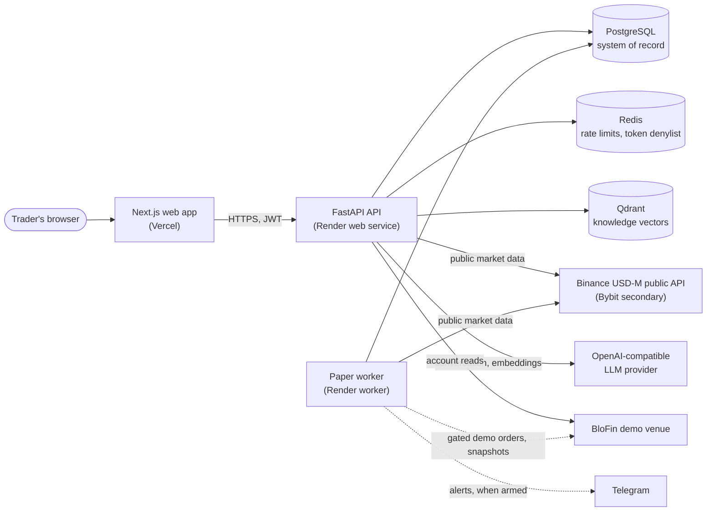

# AlphaTrade AI

**A personal AI trading workspace that connects market evidence, strategy rules, paper trades and lessons in one traceable workflow.**

AlphaTrade helps discretionary crypto traders answer three questions: *Why is this a setup? Can I act within my rules? What should I learn from the result?* A supervised worker watches public perpetual-futures data for setups defined by approved strategy versions. Deterministic services turn a confirmed setup into an immutable trade plan, check it against risk rules and the kill switch, and execute it on an internal paper ledger or the BloFin **demo** venue. Every step is recorded so it can be reviewed in the Journal and discussed with a grounded AI Agent.

[Five-minute demo](docs/demo_script.md) · [Presentation](docs/reviewer_presentation.md) · [Offline slide deck](docs/reviewer_presentation.html) · [Architecture](docs/architecture.md) · [Local setup](docs/local_setup.md) · [Current status](docs/current_status.md)

> [!IMPORTANT]
> **Paper and demo only. No real money.** AlphaTrade runs internal paper simulation (`EXCHANGE_MODE=paper_internal`, the default) or the allowlisted BloFin demo venue (`paper_exchange_demo`). `EXECUTION_MODE=paper` and `ENABLE_REAL_TRADING=false` are enforced at startup by [`paper_safety.py`](backend/src/app/core/paper_safety.py); the `trade_live` exchange mode is a tombstone that refuses to start. Real-money execution is not implemented. Paper, backtest and demo results do not show profitability or readiness for real money, and nothing here implies guaranteed returns.

## Highlights

- **Evidence with provenance.** Public Binance USD-M perpetual data is the primary source, with Bybit as a configured secondary. Source, freshness and candle finalization are checked separately; stale or missing data refuses rather than guesses.
- **Deterministic strategy detection.** The Watcher evaluates approved, compiled strategy versions. A confirmed setup becomes a **Candidate**: an opportunity with evidence attached, not an order.
- **Immutable plans and explicit authority.** Entry, size, stop and targets are bound to a plan revision and hash. A human approval, or the worker when it is separately armed, authorizes that exact revision.
- **Risk checks are final.** A risk `BLOCK` cannot be overridden. An organization **kill switch** stops new entries. The **account daily equity stop** arms it when equity falls more than 10% below the 00:00 UTC baseline. A missing or stale baseline, or unreadable equity, also arms it, and only a human can clear it. The 10% is a server setting (`ACCOUNT_EQUITY_STOP_THRESHOLD_PERCENT`, default 10, accepted range above 0 up to 50), not a trader setting. The Render Blueprint pins it at 10 on the API and the worker, so changing it takes a reviewed `render.yaml` change.
- **Tenant isolation fails closed.** Org-scoped repository reads refuse to run without an organization. Another organization's record returns the same 404 as a missing id. Failed logins are throttled per email across IPs, and request logs redact query strings and secrets. Details are in [Security](docs/security.md#hardening-november-2026).
- **Two non-live venues.** Internal paper fills are simulated in PostgreSQL. BloFin demo orders go through a governed path that reads fills back from the venue and checks stop and target protection.
- **Journal, analytics and learning.** Plans, fills and outcomes link into the Journal. Strategy changes go through validation and an explicit human promotion step.
- **Grounded Agent.** The Agent answers from scoped records and sources and drafts structured actions. A separate Confirm request is needed before anything changes.

The web app has seven primary destinations: **Dashboard**, **Autonomous** (bot limits, kill switch, leverage and per-strategy results), **Strategies**, **Trades** (the Journal, as a table of recorded trades), **Agent**, **Knowledge** and **Settings**.

## Architecture



The **API** handles authenticated requests from the web app. The **paper worker** is a separate process (`python -m app.workers.paper_worker`) that supervises the Watcher, Telegram delivery and optional components, such as the internal paper exit monitor and BloFin demo snapshot sync. API and worker share state only through PostgreSQL records, leases and fences. Dashed lines are paths that stay off until separately configured.

See [docs/architecture.md](docs/architecture.md) for the trading loop, safety layers, deployment view, Agent grounding and data model diagrams.

## Tech stack

| Layer | Technology |
| --- | --- |
| Web app | Next.js 15, React 19, TypeScript, Tailwind CSS, Recharts. Hosted on Vercel. |
| API and worker | Python 3.12, FastAPI, Pydantic v2, SQLAlchemy 2 and Alembic, LangGraph, structlog. One Docker image runs both. |
| Data | PostgreSQL (system of record), Redis (rate limiting, token denylist, optional market cache), Qdrant (knowledge vectors). |
| AI | OpenAI-compatible LLM and embedding providers behind a model router. Mock providers for local use. |
| Integrations | Binance and Bybit public market data, BloFin demo account and execution, Telegram. |
| Quality | Pytest, Ruff and mypy (backend); ESLint, TypeScript, Vitest and Playwright (frontend). GitHub Actions CI in [`ci.yml`](.github/workflows/ci.yml). |

## Quick start

The local stack uses mock providers and replayed market data (`PERPETUAL_EVIDENCE_SOURCE=replay`). It needs no exchange, Telegram or LLM credentials. Follow [docs/local_setup.md](docs/local_setup.md) for the full guide, including host development.

```sh
git clone https://github.com/Fejjii-labs/AlphaTrade-AI.git
cd AlphaTrade-AI
cp -n .env.example .env
cp -n frontend/.env.example frontend/.env.local

# PostgreSQL, Redis, Qdrant, API (applies migrations) and web app
docker compose up --build
```

Then open <http://localhost:3000> (register a synthetic user at `/register`) and check the API:

```sh
curl --fail http://localhost:8000/health
curl --fail http://localhost:8000/providers/status
```

API docs are at <http://localhost:8000/docs>. The Compose file does not include the paper worker, and it keeps real trading, the Watcher and Telegram off.

For host development, start the data services with `docker compose up -d postgres redis qdrant`, then:

```sh
# backend (terminal 1)
cd backend
uv sync --frozen --extra dev
uv run alembic upgrade head
./scripts/run_dev_server.sh

# frontend (terminal 2)
cd frontend
npm ci
npm run dev
```

Only use a disposable local database. Never point migrations, seeds or tests at a shared or staging database.

## Repository layout

```text
backend/               FastAPI app, paper worker, Alembic migrations, tests (uv)
  src/app/api/         HTTP routes
  src/app/core/        settings and safety invariants (paper_safety, exchange_safety, deployment_safety)
  src/app/services/    plans, approvals, execution, risk engine and policy, Journal, learning
  src/app/workers/     paper worker, Watcher, exit monitor, BloFin demo snapshot/activity, knowledge indexing
  src/app/providers/   LLM, embeddings, Qdrant, market data and exchange adapters
frontend/              Next.js app, unit tests (Vitest) and e2e tests (Playwright)
docs/                  architecture, runbooks, ADR-backed feature docs, diagrams
evaluation/            Agent, RAG and guardrail evaluation scripts and datasets
scripts/               deployment, smoke and validation scripts
render.yaml            Render Blueprint: staging API + paper worker
docker-compose.yml     local stack: Postgres, Redis, Qdrant, API, web app
```

## Documentation

| Topic | Guides |
| --- | --- |
| Architecture and design | [Architecture](docs/architecture.md) · [Diagrams](docs/diagrams/README.md) · [Market source contracts](docs/market_source_contracts.md) |
| Trading workflow and risk | [Risk management](docs/risk_management.md) · [Paper exit monitor](docs/paper_exit_monitor.md) · [Autonomous BloFin demo execution](docs/autonomous_blofin_demo_execution.md) · [Manual BloFin demo acceptance](docs/manual_blofin_demo_acceptance.md) |
| Agent and knowledge | [Agent workflow](docs/agent_workflow.md) · [Retrieval](docs/rag_system.md) |
| Security and operations | [Security](docs/security.md) · [Deployment](docs/deployment.md) · [Observability](docs/observability.md) · [Evaluation](docs/evaluation.md) |
| Status and limits | [Current status](docs/current_status.md) · [Limitations and roadmap](docs/limitations_roadmap.md) · [Reviewer evidence](docs/reviewer_evidence.md) |
| Presentation | [Demo script](docs/demo_script.md) · [Presentation](docs/reviewer_presentation.md) · [Technical walkthrough](docs/interview_package.md) · [Technical Q&A](docs/technical_qa.md) |

Configuration templates: [backend/local](.env.example), [frontend](frontend/.env.example), [staging](.env.staging.example). Contributors and coding agents start with [AGENTS.md](AGENTS.md).

Documentation and image links are repository-relative, so the package can be copied with its `docs/`, `frontend/` and `backend/` directories. Dated evidence documents are kept as historical records. Statements about what is deployed or observed belong in [current status](docs/current_status.md), not in this overview.
