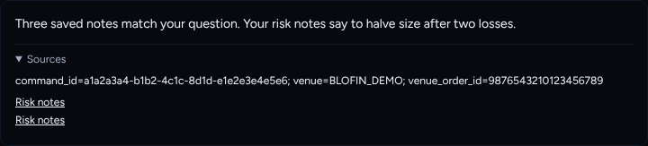
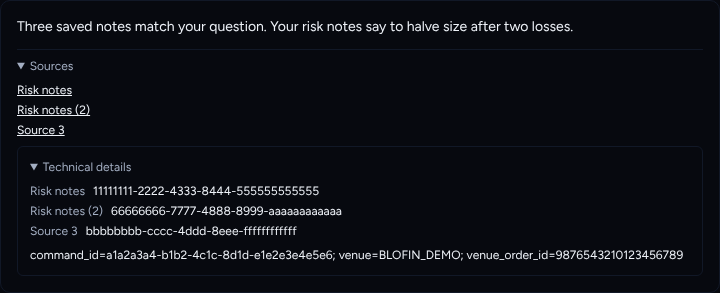
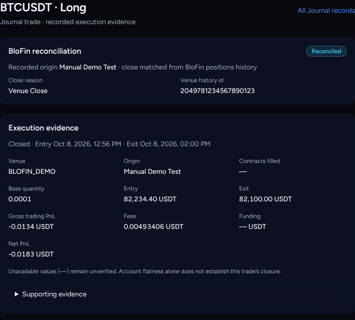
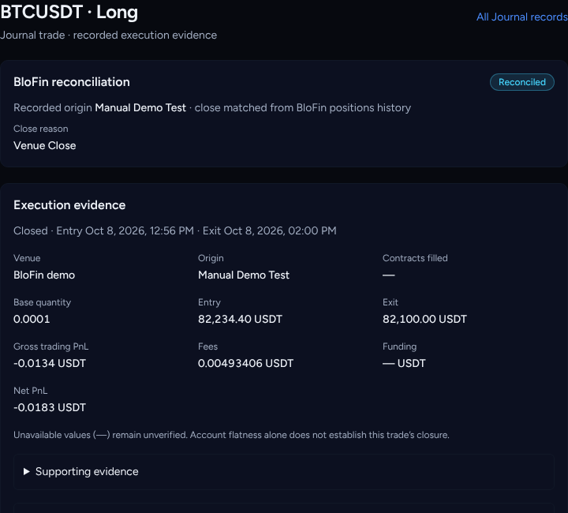
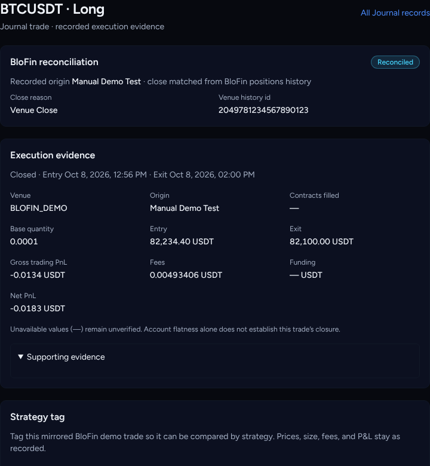
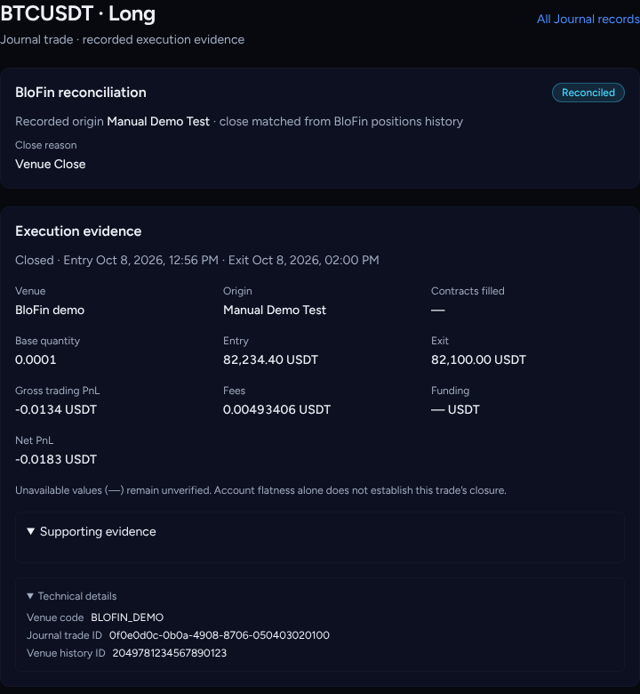

# C1b follow-ups: Technical details and distinct source names

Agent: Claude Code · Date: 2026-10-27 · Status: Done (PR open, not merged)
Follows: merged PR #343 (C1b, stop rendering IDs and hashes).
Scope: frontend only. Paper and mock data only. No backend, workflow or lockfile changes.

## What changed

1. **Technical details.** New `TechnicalDetails` component
   (`frontend/src/components/ui/technical-details.tsx`). It is a `
`,
   collapsed by default, and lists raw provenance as label/value rows plus
   optional raw text. It is marked `data-technical-details`.
   - Journal trade screen: the venue code, Journal trade ID, manual demo command ID,
     client order ID, venue order ID and venue history ID are listed here. The main
     view shows the venue as a readable label (`BLOFIN_DEMO` → "BloFin demo").
     The reconciliation card no longer shows the raw venue history ID.
   - Agent message: the Sources panel shows readable source names and links.
     Record IDs and the recorded-evidence text (for example `command_id=…`) now sit
     in a nested Technical details section inside Sources.
   - `expectNoIdentifiers()` checks only the main view. It skips
     `[data-technical-details]`, which is the only place IDs may render.
2. **Distinct source names.** `distinctSourceNames()` (`frontend/src/lib/source-names.ts`):
   - An empty or missing title becomes `Source N`, where N is the source's position
     (1-based).
   - A repeated title gets ` (2)`, ` (3)`, and so on. Case and surrounding spaces
     are ignored when comparing titles.
   - A generated name never matches a real title.
   - This applies to the Source references list (link text and `aria-label="Source: <name>"`),
     the Technical details labels, and the "Matching manual demo attempts" links
     (fallback name `Matching attempt N`).

## Decisions taken without asking

- **Numbering instead of a date.** Agent sources (`ConnectionRef`: `artifact_kind`,
  `record_id`, `title`, `relation`, `provenance`) have no date field. Adding one would
  need a backend change, so repeats are numbered instead.
- **Nested placement.** Technical details sits *inside* the existing "Sources" panel
  in agent messages. "Sources" stays the single entry point, which the existing
  AgentWorkspace tests and transcripts rely on. On the journal screen it sits beside
  "Supporting evidence".
- **Venue labels.** `venueLabel()` maps `BLOFIN_DEMO` and `PAPER`. Any other code
  falls back to `humanizeToken`.
- **Missing record IDs.** A source with no `record_id` now renders as plain text.
  Before, it linked to `…saved=unavailable`.
- **Out of scope.** `ManualDemoTest`'s existing "Stored evidence" panel (settings
  operator view) is unchanged. It is a candidate for Technical details in a later PR.
- **Branch name.** The session was assigned `claude/c1b-followups-r5lv66`, cut from the
  latest `main` (1f085d3). The request said `claude/c1b-followups`. I used the assigned
  name because pushes are limited to it.
- **Claim.** No GitHub issue is linked, so the claim is recorded in the PR description.

## Acceptance criteria

- [x] The main journal trade view shows no IDs and no raw venue code. They are in a
      collapsed Technical details section.
- [x] Agent source record IDs and recorded evidence appear only in collapsed
      Technical details.
- [x] Sources with the same title or an empty title get distinct, readable names.
- [x] Every `Source: <name>` aria-label is unique, including when titles are empty.
- [x] Focused tests cover all of the above. All of them fail on `main`'s components.

## Test evidence

Commands were run from `frontend/` after `npm ci` (lockfile unchanged).

- Focused, while iterating:
  `npx vitest run src/components/agent src/components/journal/JournalTradeScreen.test.tsx src/lib/source-names.test.ts src/lib/format.test.ts`
  → 12 files, 153 tests passed.
- Regression check: I swapped in `main`'s `AgentMessageContent.tsx` and
  `JournalTradeScreen.tsx` and ran their tests plus `AgentWorkspace.test.tsx`.
  9 of 71 tests failed: exactly the new and updated assertions. With the branch
  versions restored, all 71 pass.
- Gate, run once before the PR:
  - `npm run lint`: no warnings.
  - `npm run test`: 279 files, 1859 tests passed.
  - `npm run build`: OK.
  - `npm run typecheck`: OK. The first run failed on stale `.next/types` left by the
    screenshot harness page. It passed once those were regenerated.
- Backend: not touched, not run (`Full-Backend: false`).

## Screenshots

I captured these with Playwright (Chromium, 900px, dark). A temporary local page,
not committed, rendered both components with mock fixtures. I took them once with
`main`'s components and once with this branch's.

| Before (main) | After (this branch) |
| --- | --- |
|  |  |
|  |  |
|  |  |

Accessible names read from the rendered page:

- Before: `["Source: Risk notes","Source: Risk notes","Source: "]`. The last one is an empty link.
- After: `["Source: Risk notes","Source: Risk notes (2)","Source: Source 3"]`.

## Next steps

Griller review on the PR head. Sofien decides on merge.
