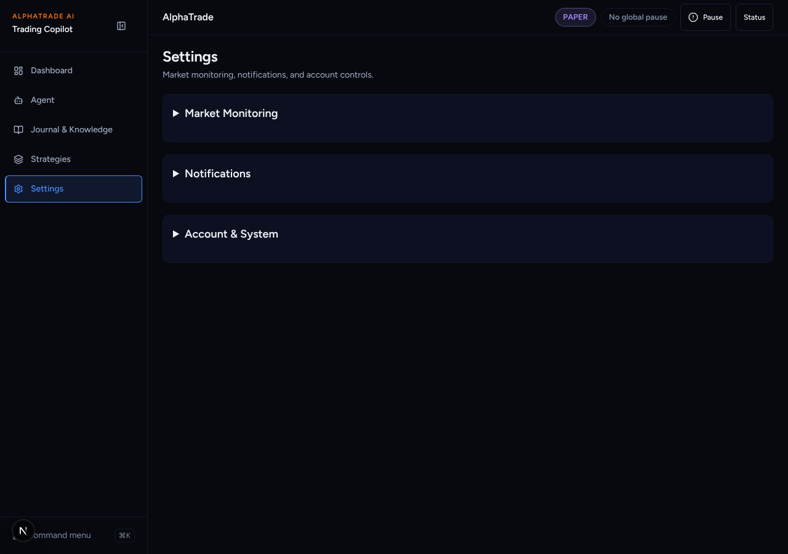
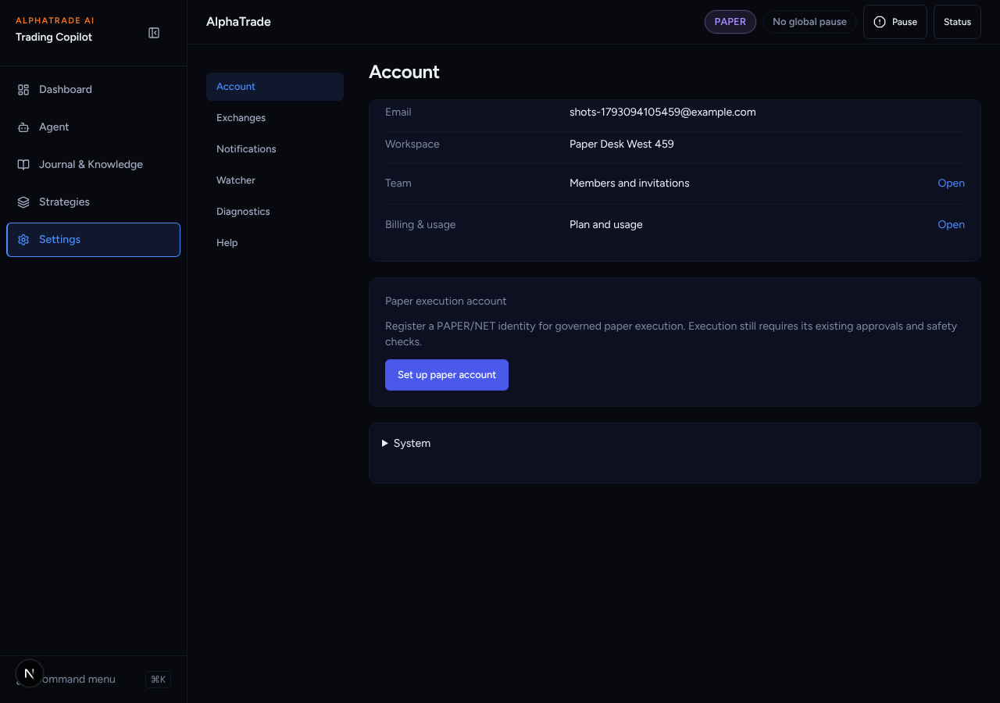
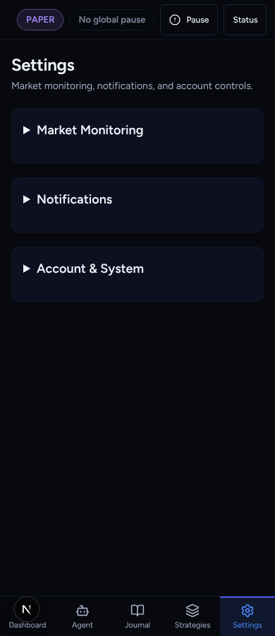
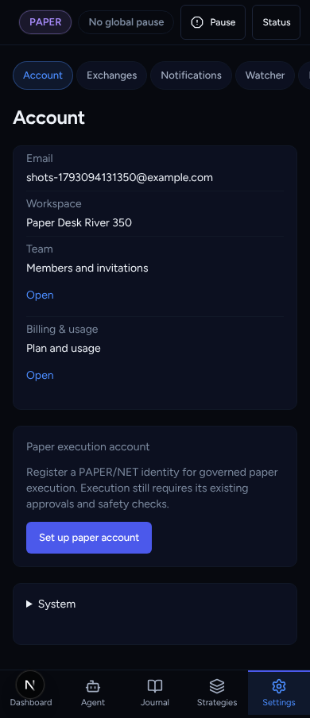

# UI overhaul B2a: Settings sub-nav

Agent: Claude Code · Date: 2026-10-27 · Status: Done (PR open, not merged)
Plan: `docs/plans/2026-10-26-ui-overhaul-plan.md`, item **B2a**.
Stacked on B1 (#352): the route registry test needs the two new routes registered.
Scope: frontend only. No backend, API schema, workflow or lockfile changes.

## What changed

- **Sub-nav.** New `components/ui/sub-nav.tsx` (`<nav>` of links with
  `aria-current`). It is a rail from `lg` up and a row of scrolling chips on phones.
  A new `settings/layout.tsx` puts it on every `/settings/*` page. The sections
  are Account · Exchanges · Notifications · Watcher · Diagnostics · Help
  (`lib/navigation/settings-sections.ts`).
- **New routes.**
  - `/settings/notifications`: `NotificationSettingsPanel`, which already
    contains `TelegramPolicyForm`.
  - `/settings/watcher`: watcher status, watchlist slots, coin strategies, worker
    runtime readout.
- **Account (`/settings`).** The page is flat now: Email, Workspace, Team →,
  Billing & usage →, email verification, paper account, and a closed "System"
  disclosure. The link row (Exchange connections / Team / Billing / Diagnostics /
  Help) is gone. Each of those is a sub-nav section or a row with an Open link.
- **Old anchors.** `/settings#notifications` and `/settings#markets` are forwarded
  client-side with `router.replace` to the new routes. `#account-system` stays on
  Account.
- **Removed duplicates.** The "Back to Settings" strip is hidden on `/settings/*`
  (the sub-nav replaces it; it stays on the diagnostics routes outside Settings).
  Help lost its own "← Back to Settings" link and now uses `PageHeader`.
- Registry: `/settings/notifications` and `/settings/watcher` registered as `section`.

## Decisions taken without asking

- **Stacked on B1.** The B1 registry test fails if a page is not registered, so
  this branch is cut from `claude/ui-overhaul-b1-route-registry`. The PR's base is
  that branch, so the diff shows only B2a.
- **Diagnostics link points at `/settings/advanced` for now.** B2b creates
  `/settings/diagnostics` and redirects `/settings/advanced`. `/settings/audit`
  counts as Diagnostics.
- **Provider health stays in Account → System for now.** It is a closed
  disclosure. B2b moves it into Diagnostics as colour-coded status tiles.
- **`/watchlist` is not redirected yet.** The kill switch lives there. The plan
  moves it to Autonomous first (B3a).
- **Watcher refresh button is named "Refresh watcher".** The coin-strategies
  card already has its own "Refresh".
- **Playwright specs updated** for the new structure (they run in CI's
  e2e-smoke): `e2e/notification-settings-v2.spec.ts` (URL, session check, the
  Watcher check now navigates through the sub-nav) and
  `e2e/workspace-redesign.spec.ts` (6 sub-nav links instead of 3 groups).

## Acceptance criteria (plan B2a)

- [x] Sub-nav tests: order, exactly one active section on each of 9 Settings
      paths, phone scroll / desktop rail classes (`settings/layout.test.tsx`).
- [x] Hash forward tests: `#notifications` → `/settings/notifications`,
      `#markets` → `/settings/watcher`, `#account-system` stays
      (`settings/page.test.tsx`, plus a real browser run of
      `/settings#notifications` in `notification-settings-v2.spec.ts`).
- [x] The existing settings tests pass. They were rewritten for the new pages,
      with the same safety assertions: no risk/notification writes, account
      switch clears state, unknown values stay "Unavailable".
- [x] The link row is removed.

## Test evidence

From `frontend/`:

- `npx vitest run "src/app/(app)/settings" src/components/layout src/lib/navigation`
  → 15 files, 179 tests passed.
- `npx playwright test e2e/notification-settings-v2.spec.ts e2e/auth-boundary.spec.ts --project=chromium`
  → 9 passed (mock-mode backend + `next dev`).
- `npx playwright test e2e/workspace-redesign.spec.ts --project=chromium` → 2 passed.
- `npx eslint` on the touched files → clean. `npx tsc --noEmit` → clean.
- Backend: not touched (`Full-Backend: false`).

## Screenshots

Mock-mode backend (SQLite, `PROVIDER_MODE=mock`), a freshly registered paper
user, Chromium, dark. "Before" is `main`; "after" is this branch.

| Before | After |
| --- | --- |
|  |  |
|  |  |

New pages: [Notifications](ui-overhaul-b2a-settings-subnav/after-notifications-1280.png),
[Watcher](ui-overhaul-b2a-settings-subnav/after-watcher-1280.png),
[Help](ui-overhaul-b2a-settings-subnav/after-help-1280.png).

## Follow-ups noted

- Watcher status and worker runtime are still text rows. B2b adds `StatusTile`,
  and the Watcher readout can adopt it then.

## Next steps

Griller review. Then B2b (Diagnostics).
