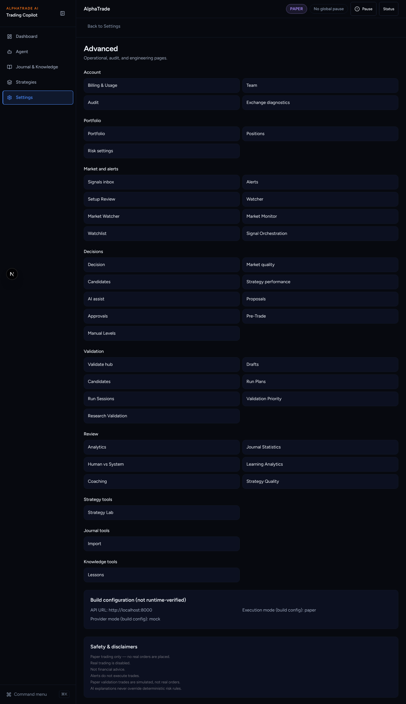
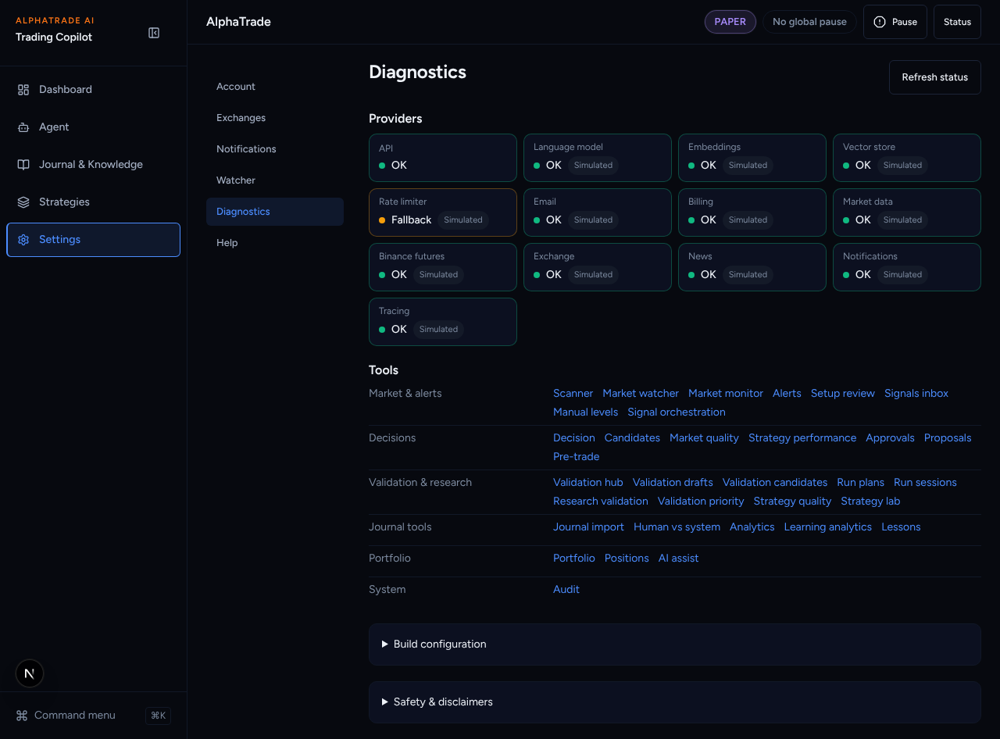
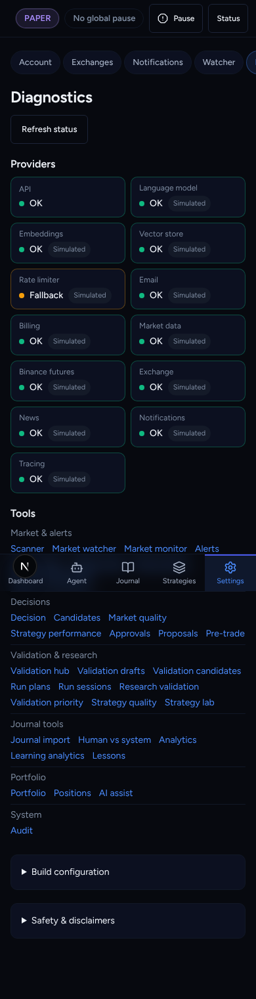
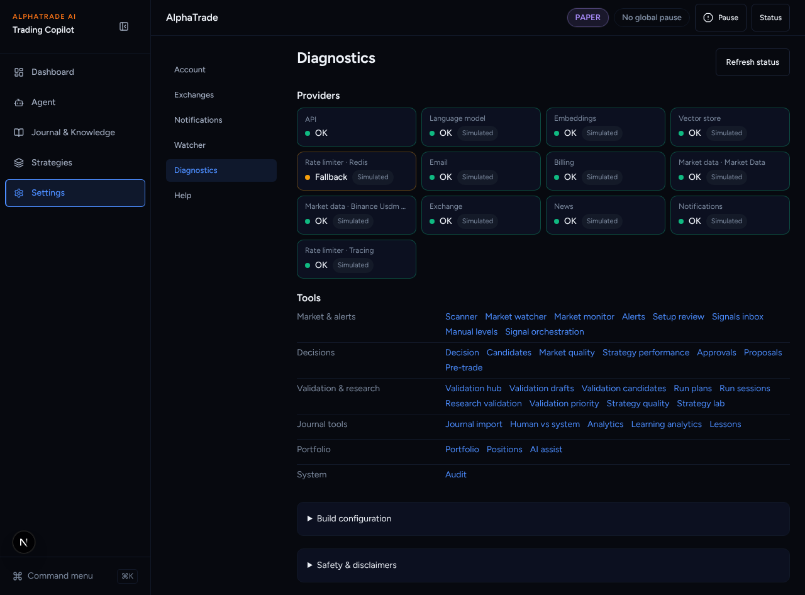
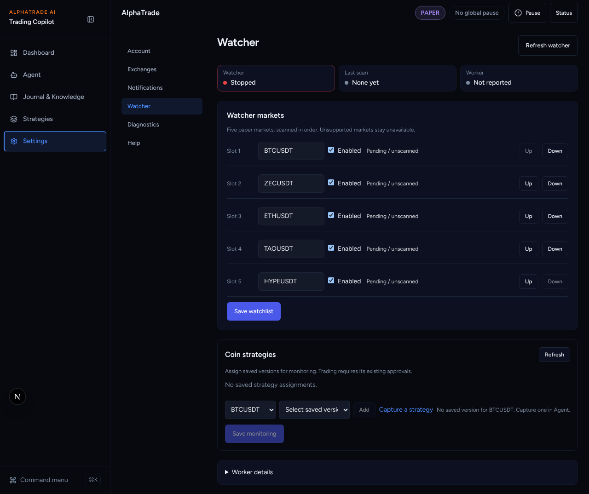

# UI overhaul B2b: Diagnostics

Agent: Claude Code · Date: 2026-10-27 · Status: Done (PR open, not merged)
Plan: `docs/plans/2026-10-26-ui-overhaul-plan.md`, item **B2b**.
Stacked on B2a (#354), which is stacked on B1 (#352).
Scope: frontend only. No backend, API schema, workflow or lockfile changes.

## What changed

- **`/settings/diagnostics` (new).**
  - Providers: API health plus each provider as a **status tile** (new
    `components/ui/status-tile.tsx`). A tile has a name, a coloured dot
    (green OK / amber Degraded or Fallback / red Down / grey Unknown), a one-word
    state, and a grey "Simulated" tag for mock providers. Raw provider names
    (`mock-llm`, `binance-usdm-perpetual-replay`) are not shown. Tiles are named
    by kind ("Language model", "Market data") or a known name ("Binance
    futures", "Rate limiter"). A repeated name gets "(2)" (`lib/status-tiles.ts`).
  - Tools: every `diagnostics` route from the B1 registry, one row per group,
    links inline.
  - Build configuration and Safety & disclaimers are closed disclosures.
- **`/settings/advanced` → `/settings/diagnostics`** (`next.config` redirect).
  The old `page.tsx` stays and re-exports the new page.
- **`advanced-routes.ts` no longer keeps its own list.** `ADVANCED_ROUTES` is
  generated from the registry's diagnostics routes. The command menu adds the
  registry's section pages (group "Pages") and diagnostics (group
  "Diagnostics"). Page subtitles read registry labels.
- **Account** loses the "System" disclosure; provider health now lives in
  Diagnostics.
- **Watcher** shows Watcher / Last scan / Worker as status tiles. The long
  worker readout moved into a closed "Worker details" disclosure.
- Sub-nav "Diagnostics" now points at `/settings/diagnostics`
  (`/settings/advanced` and `/settings/audit` also mark it current).

## Decisions taken without asking

- **Tones.** Degraded and fallback are amber, unavailable is red, unknown or
  missing is grey. Watcher STOPPED/BLOCKED is red, DEGRADED/STALE amber, RUNNING
  green.
- **Registry labels are now the user-visible names** in the command menu and
  subtitles, so a few changed: "Setup Review" → "Setup review", "Import" →
  "Journal import", "Candidates" (paper validation) → "Validation candidates",
  "Watcher" (scanner) → "Scanner".
- **`ProviderStatusCard.tsx` is left in place, unused.** Deleting files needs
  Sofien's OK (plan §2). The tile replaces it in the UI.
- **The Account/Exchanges/Team/Billing entries left the Advanced list.** They
  are Settings sections now, reachable from the sub-nav and the command menu.

## Acceptance criteria (plan B2b)

- [x] Every advanced (diagnostics) route appears in Diagnostics: a test checks
      the page's links against the registry and `ADVANCED_ROUTES`.
- [x] Tile colour tests: OK/green, Degraded/amber, Down/red, Fallback/amber,
      Unknown/grey, Simulated tag, readable unique names.
- [x] `/settings/advanced` redirects (B1 registry test checks `next.config`
      and that it lands on a real page).

## Test evidence

From `frontend/`:

- `npx vitest run "src/app/(app)/settings" src/components/layout src/lib`
  → 50 files, 466 tests passed.
- Full suite on the stack tip (B1 → B3a): `npx vitest run` → 281 files,
  1952 tests passed.
- Full Playwright suite on a production build of the stack tip (B1 → B3a),
  chromium, mock backend: 55 passed, 14 skipped (staging-only), 1 failed
  (`readiness-validation`, a 429 from my long-lived local backend). With a fresh
  backend, `readiness-validation.spec.ts` → 4 passed.
- `npx eslint` on the touched files → clean. `npx tsc --noEmit` → clean.
  `next build` → OK.
- Backend: not touched (`Full-Backend: false`).

## Screenshots

Mock backend, fresh paper user. Before = `main`.

| Before: `/settings/advanced` | After: `/settings/diagnostics` |
| --- | --- |
|  |  |

Phone: .
`/settings/advanced` after the redirect:
.
Watcher with tiles: .

## Next steps

Griller review. Then B3a (Autonomous page).
