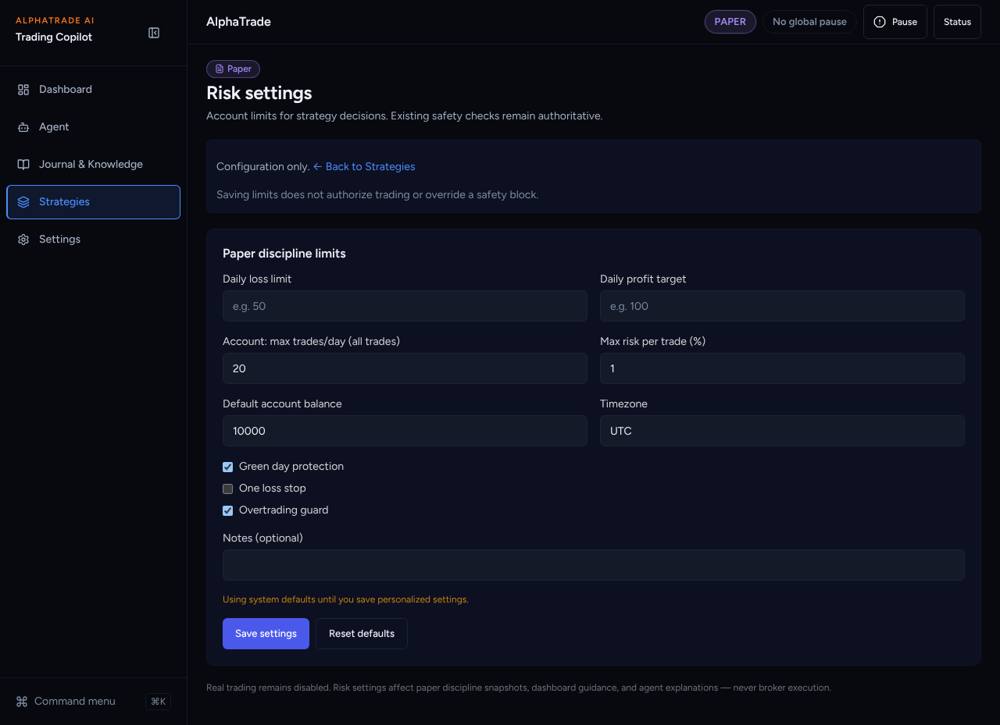
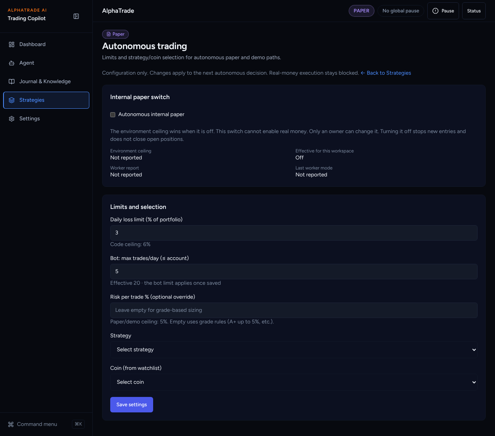
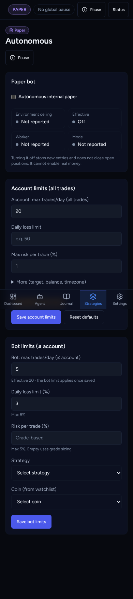
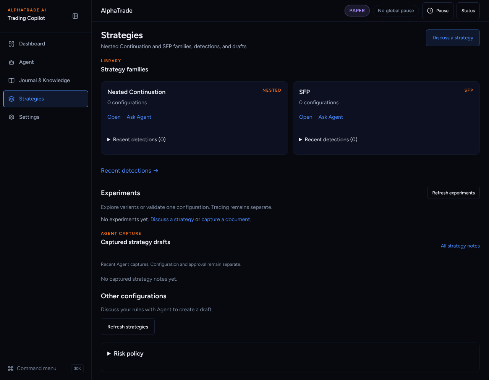
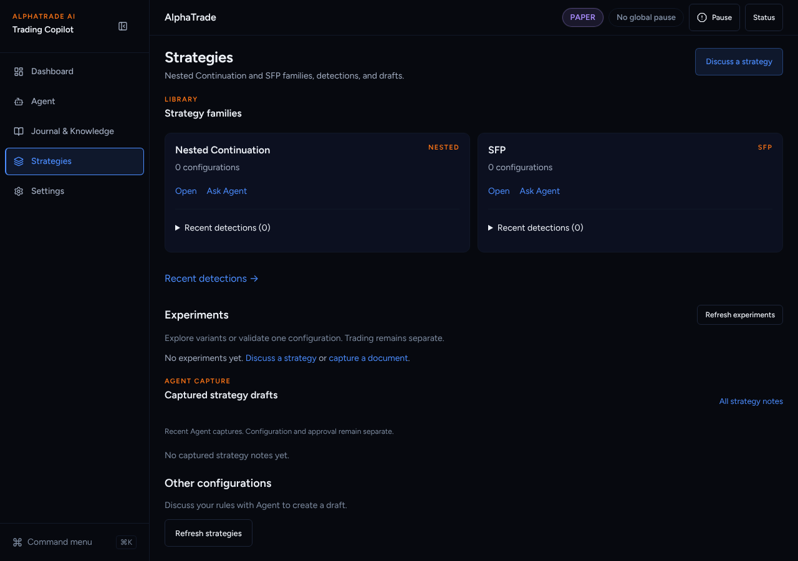
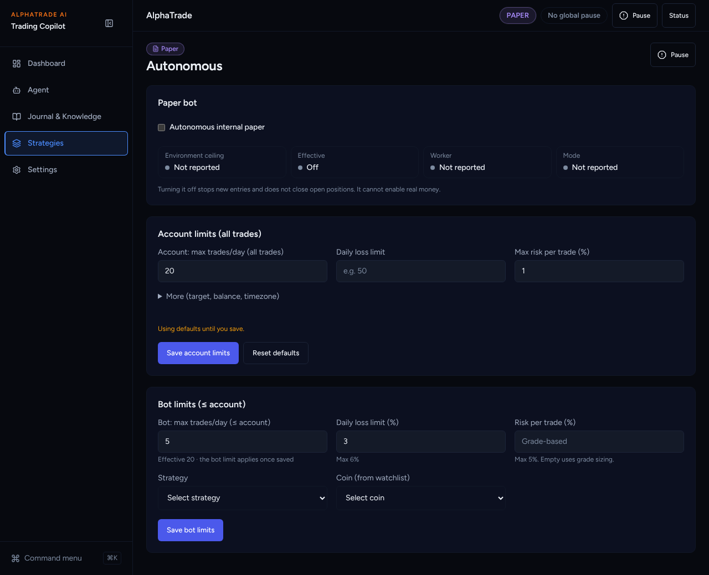
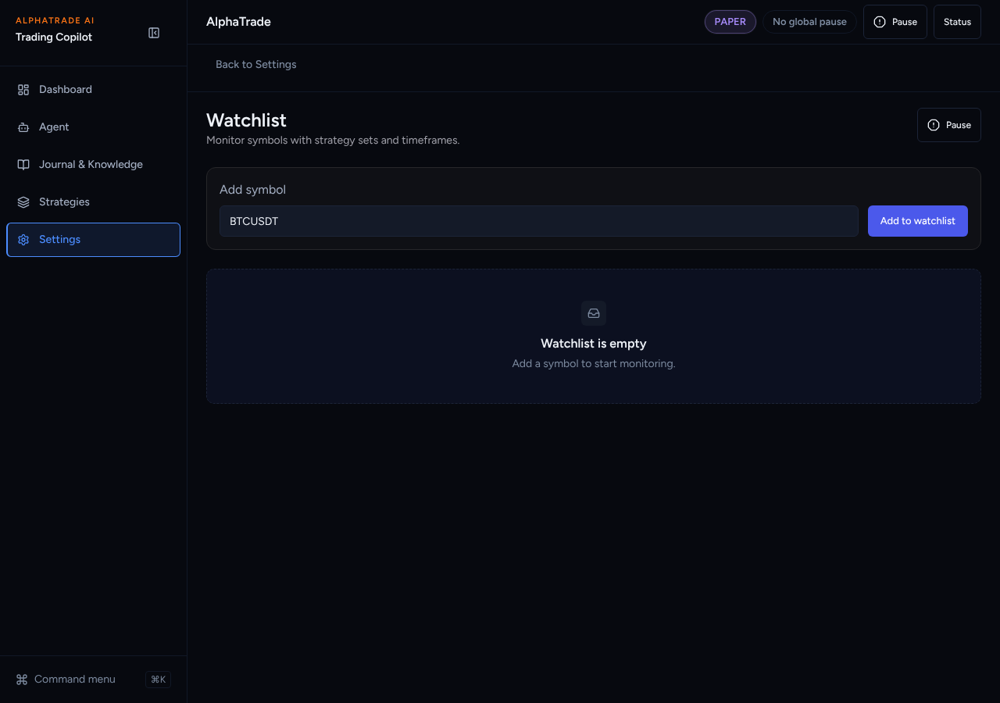

# UI overhaul B3a: Autonomous page

Agent: Claude Code · Date: 2026-10-27 · Status: Done (PR open, not merged)
Plan: `docs/plans/2026-10-26-ui-overhaul-plan.md`, item **B3a**. A3 (#340) is
merged, as the plan requires.
Stacked on B2b (#355) → B2a (#354) → B1 (#352).
Scope: frontend only. No backend, API schema, workflow or lockfile changes.
`TopBar.tsx` is not in the diff (Griller sequencing condition).

## What changed

- **`/autonomous` (new)** puts the paper bot and both trade caps on one page,
  in wireframe order:
  1. **Paper bot.** The owner-only switch plus four status tiles: environment
     ceiling, effective, worker, mode. The safety note stays: turning it off stops
     new entries and does not close open positions.
  2. **Account limits (all trades)** (`#account`). Account max trades/day, daily
     loss limit and max risk per trade are shown first. Target, balance,
     timezone, the three guards and notes sit under a closed "More".
  3. **Bot limits (≤ account)** (`#bot`). Bot max trades/day with "Effective N",
     daily loss %, risk per trade %, strategy and coin.
  - The **kill switch** (`KillSwitchButton`) is in the page header. The risk
    BLOCK panel and the paper indicator stay (`PortfolioHubChrome`, which gains
    an `actions` prop).
- **The forms are components now.**
  - `components/autonomous/AccountLimitsCard.tsx`, from `/risk`.
  - `components/autonomous/BotSettings.tsx`, from `/risk/autonomous`.
  - Their tests moved with `git mv` and keep the owner gating, role reasons,
    effective-cap, bot > account and ceiling-message cases.
- **Redirects.**
  - `/risk` → `/autonomous#account`
  - `/risk/autonomous` → `/autonomous#bot`
  - `/watchlist` → `/settings/watcher` (the kill switch is on Autonomous now)
  - The `page.tsx` files stay. The two risk pages re-export the Autonomous page.
- **Strategies.** The "Risk policy" disclosure is gone. An old
  `/strategies#risk` link forwards to `/autonomous#account`.
- **Registry and navigation.**
  - `/autonomous` is registered (primary). `/risk`, `/risk/autonomous` and
    `/watchlist` are registered as redirects.
  - `/autonomous` highlights Strategies until B6 gives it a sidebar item.

## Decisions taken without asking

- **Kill switch appears twice.** It is on the page and still in the TopBar's
  "Pause" (the TopBar must not change). Same component, same state.
- **Account limits sit between the bot switch and bot limits**, as in the
  wireframe, so the bot cap reads after the account cap it is held to.
  `BotSettings` takes a `between` slot for this.
- **Tile tones.** On is green and Off is grey (off is a normal choice, not a
  fault). Worker Fresh is green, Stale amber, Not reported grey.
- **Copy cut.** The "Configuration only…", "Back to Strategies" and footnote
  paragraphs are gone. Buttons are "Save account limits" / "Save bot limits".
- **`/watchlist` capability.** The legacy `/watchlist` page (the old
  `api.watchlist` list) is redirected as the plan says. Its file is kept;
  deleting needs Sofien's OK.
- **`RiskSettingsSummary` is now unused.** It is left in place, since deleting
  needs approval.
- **Size.** +703/−753 lines, mostly the move of two pages into components.

## Acceptance criteria (plan B3a)

- [x] Old routes redirect (`/risk`, `/risk/autonomous`, `/watchlist`). Tested in
      `autonomous/page.test.tsx` and the B1 registry test.
- [x] The owner-gating and both form tests are kept and pass
      (`BotSettings.test.tsx`, `AccountLimitsCard.test.tsx`).
- [x] The kill switch is reachable on `/autonomous` (header test).
- [x] Risk policy is removed from `/strategies` (test).
- [x] `TopBar.tsx` is not in the diff.
- [x] Both trade caps are kept and labelled separately; effective = min is shown.

## Test evidence

From `frontend/`:

- `npx vitest run src/components/autonomous "src/app/(app)/autonomous" "src/app/(app)/strategies" src/lib src/components/layout src/components/portfolio "src/app/(app)/settings"`
  → 63 files, 563 tests passed (before the card-order change). After it:
  `npx vitest run src/components/autonomous "src/app/(app)/autonomous"` → 20 passed.
- Full `npx vitest run` on this head → 281 files, 1952 tests passed.
- Full Playwright suite on a production build of this stack (chromium, mock
  backend): 55 passed, 14 skipped (staging-only), and 1 failure from a 429 on my
  long-lived local backend. `readiness-validation.spec.ts` rerun on a fresh
  backend → 4 passed. It covers `/risk` → one h1, no overflow, paper posture.
- eslint → clean. `tsc --noEmit` → clean. `next build` → OK.
- Backend: not touched (`Full-Backend: false`).

## Screenshots

Mock backend, fresh paper user (owner). Before = `main`.

| Before | After |
| --- | --- |
|  |  |
|  |  |
|  |  |

`/risk` after the redirect lands on `#account`:
.
Old `/watchlist`: .

## Next steps

Griller review. Then B3b (bot activity). B3b needs a backend read: see its report.
