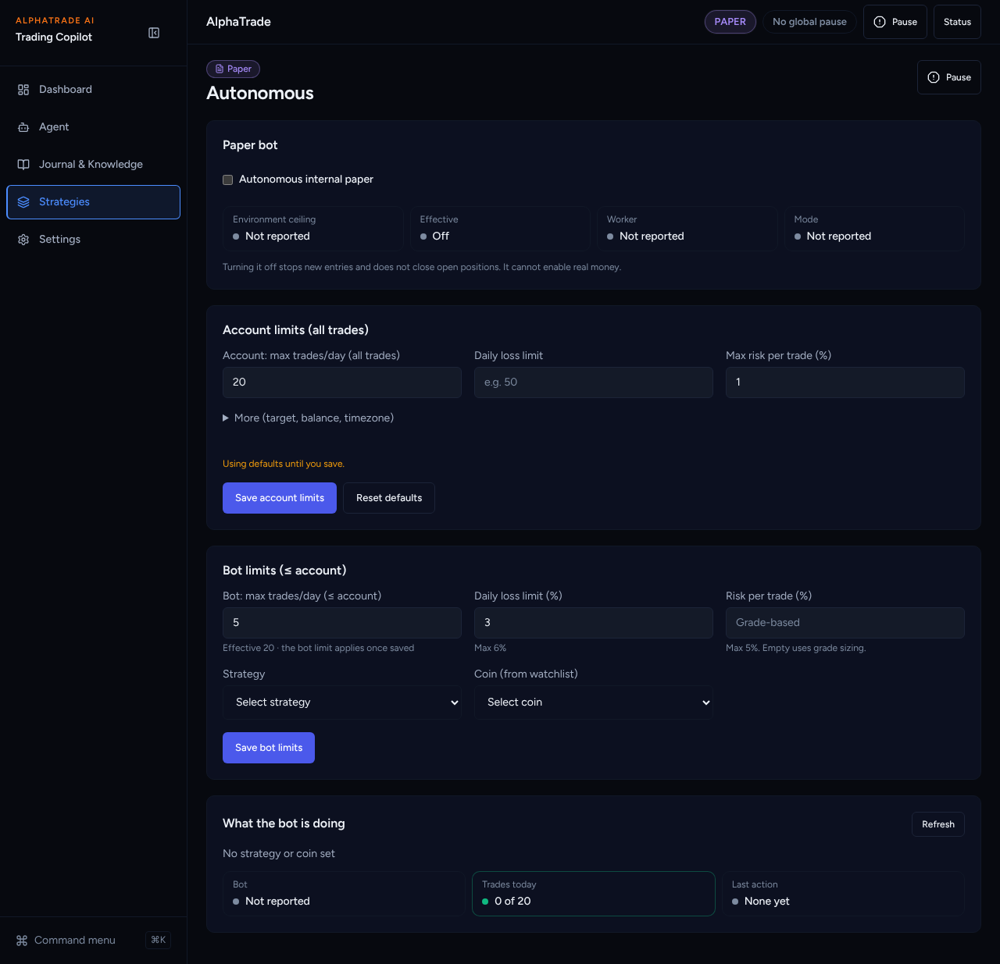
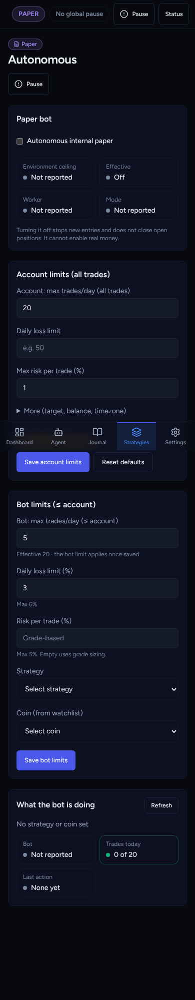

# UI overhaul B3b: What the bot is doing

Agent: Claude Code · Date: 2026-10-27 · Status: Done (two PRs open, not merged)
Plan: `docs/plans/2026-10-26-ui-overhaul-plan.md`, item **B3b**.

The plan says: first check whether the existing reads are enough, and if a
backend read is needed, give it its own PR. They were not enough, so B3b is two PRs:

| PR | Branch | Base | Scope |
| --- | --- | --- | --- |
| B3b-api | `claude/ui-overhaul-b3b-bot-activity-api` | `main` | backend read endpoint + regenerated contract |
| B3b-ui | `claude/ui-overhaul-b3b-bot-activity-ui` | B3a branch | the panel |

## Why the existing reads were not enough

- **Today's count.** The bot cap (`autonomous_max_trades_reached`) compares the
  bot limit with `DailyRiskAccounting.sync_from_portfolio(...).trade_count`
  (paper fills + canonical trades). The dashboard's `trades_today`
  (`services/dashboard/daily_discipline.py`) counts the `PaperTrade` table
  instead. Showing that number next to the bot cap could disagree with what is
  enforced.
- **Last actions.** The paper loop audits entered / blocked / rejected
  decisions (`resource_type="automated_paper_loop"`), but `/audit/events`
  cannot filter by resource type, and the rows hold no symbol.

## What changed

**B3b-api** (`backend/src`, so this PR runs the full backend gate):

- `GET /autonomous/activity` (reader role, the same rate limit as settings):
  - `trades_today` is the bot-cap count. It is computed inside a savepoint that
    is **always rolled back**, so reading never writes `daily_risk_states`. An
    unreadable count comes back as `null`.
  - `recent_actions`: the last 5 paper-loop audit rows for this user
    (entered / blocked / rejected), newest first, with symbol and side from the
    linked journal trade, and the recorded reason code.
- New files: `schemas/autonomous_activity.py`,
  `services/autonomous_activity.py`, `tests/test_autonomous_activity.py`.
  The route is added to `api/routes/autonomous_trading_settings.py`.
  No hot file changes: `services/risk/` is only called, not edited.
- `npm run api:generate` → `openapi.json` / `hashes.json` updated;
  `npm run api:check` passes.

**B3b-ui** (frontend):

- `components/autonomous/BotActivityPanel.tsx` sits at the bottom of
  `/autonomous`. It shows the strategy · coin, then three tiles:
  - **Bot**: Running (green), Stale (amber), Off or Not reported (grey).
  - **Trades today**: "N of effective cap". Green below the cap, amber at it,
    grey "Unknown" when not readable.
  - **Last action**: Entered (green), Blocked (amber) or Rejected (red), with a time.
  - A closed "Last N actions" list, with a Trade link for entries.
- `api.autonomous.activity()` and the `AutonomousActivityView` type are new.

## Decisions taken without asking

- **Two PRs**, per the plan's own rule for B3b.
- **Only audited actions are listed.** Pre-check refusals (kill switch, stale
  evidence, bot cap reached, missing account) return without an audit row, so
  they cannot appear. I did not add auditing to the paper loop: it would change
  `automated_paper_loop.py` behaviour and add writes. Follow-up candidate.
- **The count is the one the bot cap enforces**, all paper trades today, not
  bot-only. It is labelled "Trades today" next to the effective cap, which is
  exactly what the guard compares.
- **Honest empty states.** No actions → "None yet". Endpoint unavailable (for
  example before B3b-api is deployed) → "Bot activity unavailable." and
  "Unknown", never zeros.
- **No seeded data in screenshots.** The screenshot user is fresh, so it shows
  the honest empty state. The filled states are covered by unit tests.

## Acceptance criteria (plan B3b)

- [x] vitest for running, idle, stale and empty (plus at-cap, unknown count, unavailable).
- [x] It shows today's used / effective count.
- [x] The backend read has its own PR with pytest and the full gate.

## Test evidence

B3b-api (from `backend/`):

- `uv run pytest tests/test_autonomous_activity.py` → 7 passed.
- Mutation: with the savepoint committed instead of rolled back, 2 tests fail
  (the no-write checks). Restored → 7 passed.
- `uv run ruff check .` / `uv run ruff format --check .` → clean.
- Full gate: see the B3b-api PR (run on its head against local Postgres 16).
- `npm run api:generate` then `npm run api:check` → "API drift check passed".

B3b-ui (from `frontend/`):

- `npx vitest run src/components/autonomous "src/app/(app)/autonomous"` → 27 passed.
- eslint → clean. `tsc --noEmit` → clean. `next build` → OK.
- The endpoint was checked live: a fresh user gets
  `{"day":"2026-10-27","timezone":"UTC","trades_today":0,"recent_actions":[]}`.

## Screenshots

Production build of this branch, against a mock backend running B3b-api, with a
fresh paper user (honest empty state).

| Before (`/risk/autonomous` on main) | After (`/autonomous`, bottom panel) |
| --- | --- |
|  |  |

Phone: 

## Next steps

Griller review of both PRs. B3b-api needs a merge and deploy before the panel
shows data; until then it reports "unavailable".
