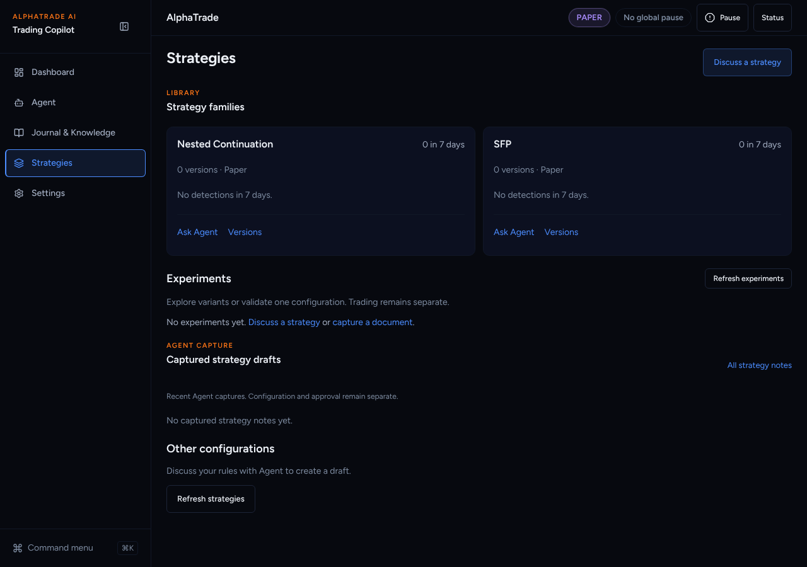
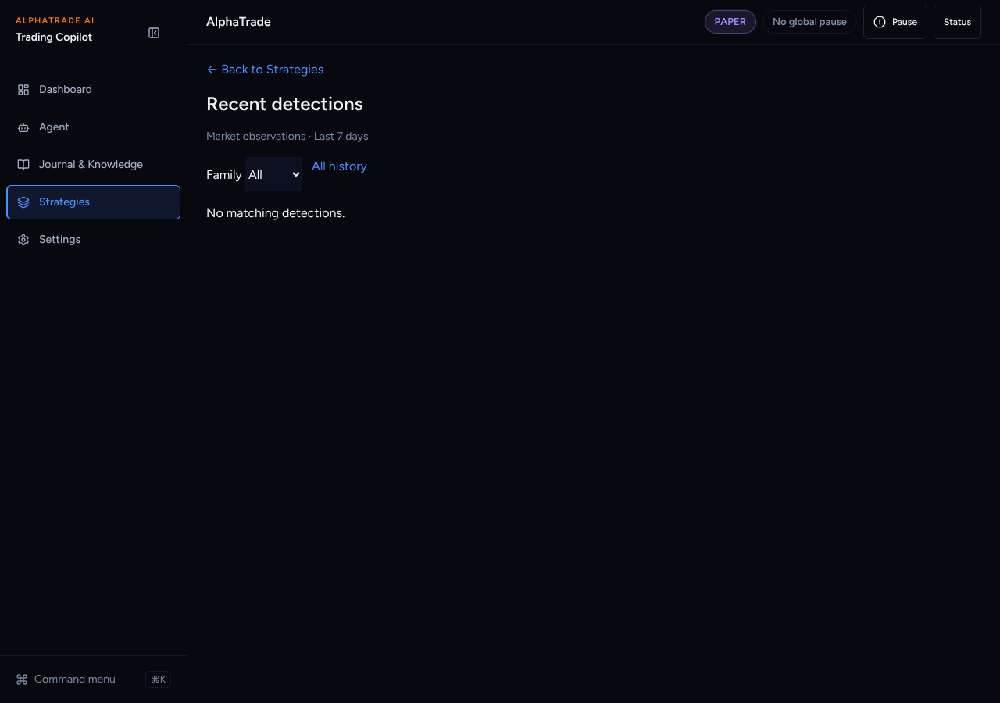
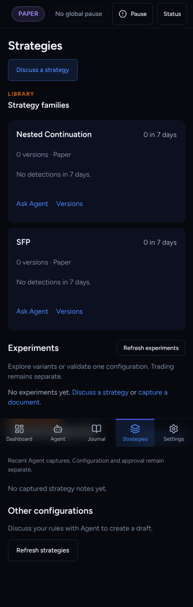

# UI overhaul B4: Strategy cards with in-card history

Agent: Claude Code · Date: 2026-10-27 · Status: Done (PR open, not merged)
Plan: `docs/plans/2026-10-26-ui-overhaul-plan.md`, item **B4**. It uses the
A2 per-family query, which is already merged.
Stacked on B3b-ui (#357), because B3a changed the same Strategies page.
Scope: frontend only.

## What changed

- **Family card** (new `components/strategies/FamilyCard.tsx`), following the wireframe:
  - **Header:** the family name and "N in 7 days". N is the server total
    (`setup_count`), not the 20-row bound.
  - **Versions line:** "2 versions · Paper", or "Versions unavailable".
  - **7-day bars**, one per local day, with an `aria-label` that lists the counts.
    They are hidden when the week is empty.
  - **The latest 3 detections:** symbol · side · timeframe · stage, then time →.
    Each links to the setup detail.
  - **The rest** of the loaded week sits under a closed "Show all 7 days".
  - **Honest bounds:** when the server total is larger than the rows it
    returned, the card says "Bars and list cover the latest 20."
  - **Actions:** Ask Agent · Versions (the family's version list).
- **Removed:**
  - the standalone "Recent detections →" link and "Browse detections";
  - the `nested` / `sfp` eyebrow;
  - the header descriptions;
  - "Approval, validation and automation are separate." on versions.
- **Raw JSON cut.** "Rules & evidence" used to show
  `JSON.stringify(spec)`. It is now "Rules": readable label/value rows
  (`components/strategies/StrategyRules.tsx`). Nested objects, `*_id` keys,
  UUID values and schema markers (`kind`, `version`, `provisional`) are left out.
  Version status is humanized.
- **`/strategies/detections` → `/strategies`** (`next.config`). The page stays.
  The setup detail's back link now always reads "← Back to Strategies".

## Decisions taken without asking

- **"Versions" is a link, not a disclosure.** The family view
  (`/strategies?family=…`) already lists versions with their rules. Copying it
  into the card would double the content.
- **Bars from the loaded rows.** The server returns at most 20 rows per family. The
  bars count those rows and say so when the total is larger, instead of guessing.
- **Days are local days** (browser time zone), labelled with narrow weekday letters.
- **Specs.** Object-valued parameters are skipped rather than shown as JSON.
- **Playwright specs updated:** `e2e/workspace-redesign.spec.ts` (the
  "Open" link is now "Versions", and the detections page redirects) and
  `ui-tests/frontend-refinement.spec.ts` (not in CI; updated for consistency).

## Acceptance criteria (plan B4)

- [x] vitest for per-family history and counts: `FamilyCard.test.tsx`, plus page
      tests for Nested behind a busy SFP week and a server total above the bound.
- [x] Redirect test: B1 registry test (`/strategies/detections` lands on
      `/strategies`, and `next.config` serves it).
- [x] Raw JSON is cut (`StrategyRules` test: no `{`, no IDs, no schema markers).

## Test evidence

From `frontend/`:

- `npx vitest run src/components/strategies "src/app/(app)/strategies" src/lib/navigation src/components/layout`
  → 219 passed. After the empty-bars change:
  `npx vitest run src/components/strategies "src/app/(app)/strategies"` → 69 passed.
- eslint → clean. `tsc --noEmit` → clean. `next build` → OK.

## Screenshots

Production build, mock backend, fresh paper user. The user has no detections,
so the cards show the honest empty state. Filled cards (bars, rows, "Show all")
are covered by `FamilyCard.test.tsx`. I seeded no data.

| Before | After |
| --- | --- |
|  |  |

Old `/strategies/detections`: .
Phone: .

## Next steps

Griller review. Then B5a (Trades / Stats tabs, Knowledge split).
