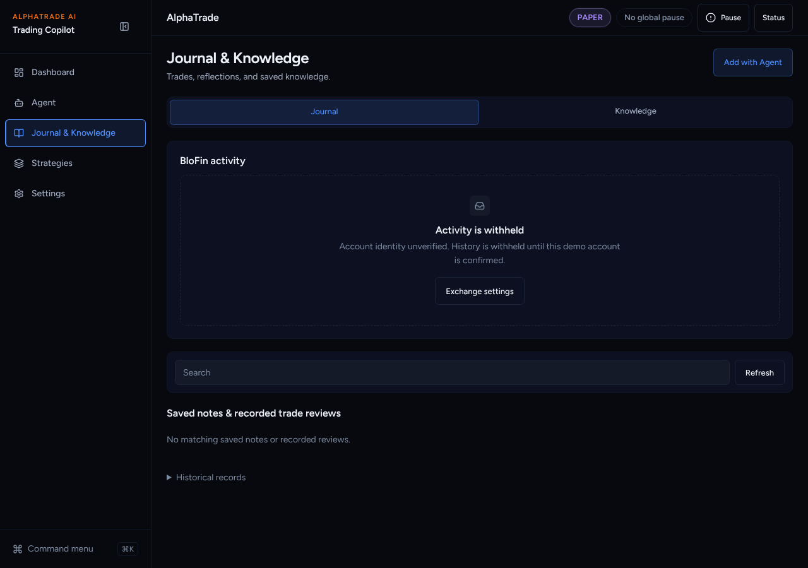
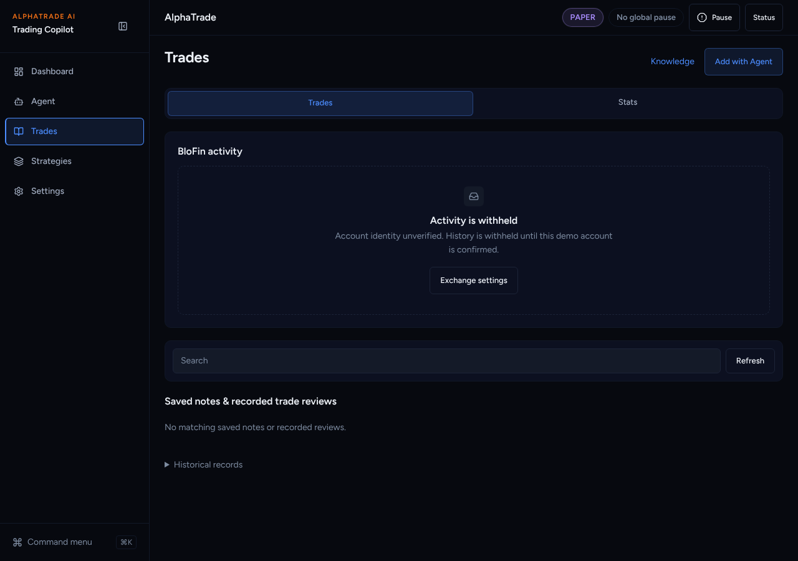
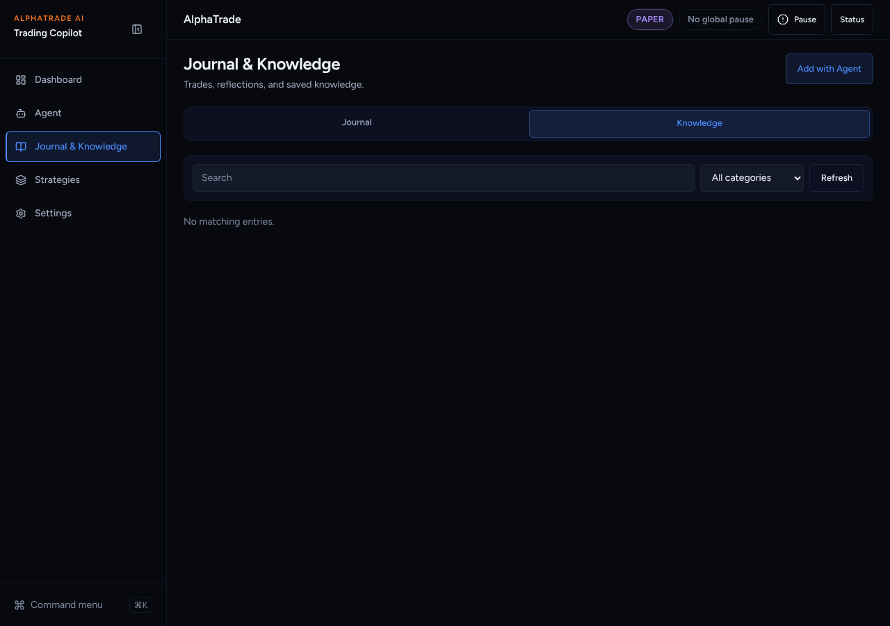
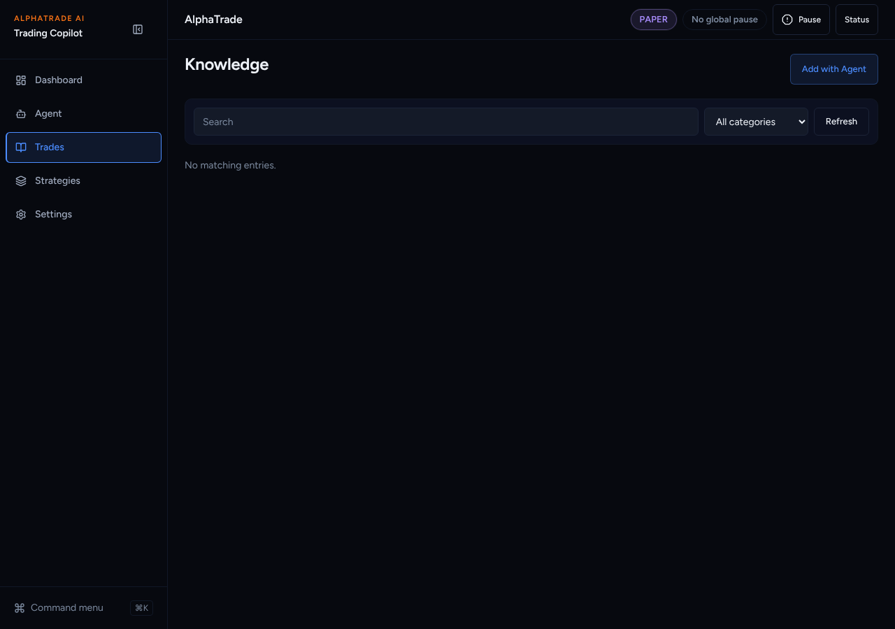
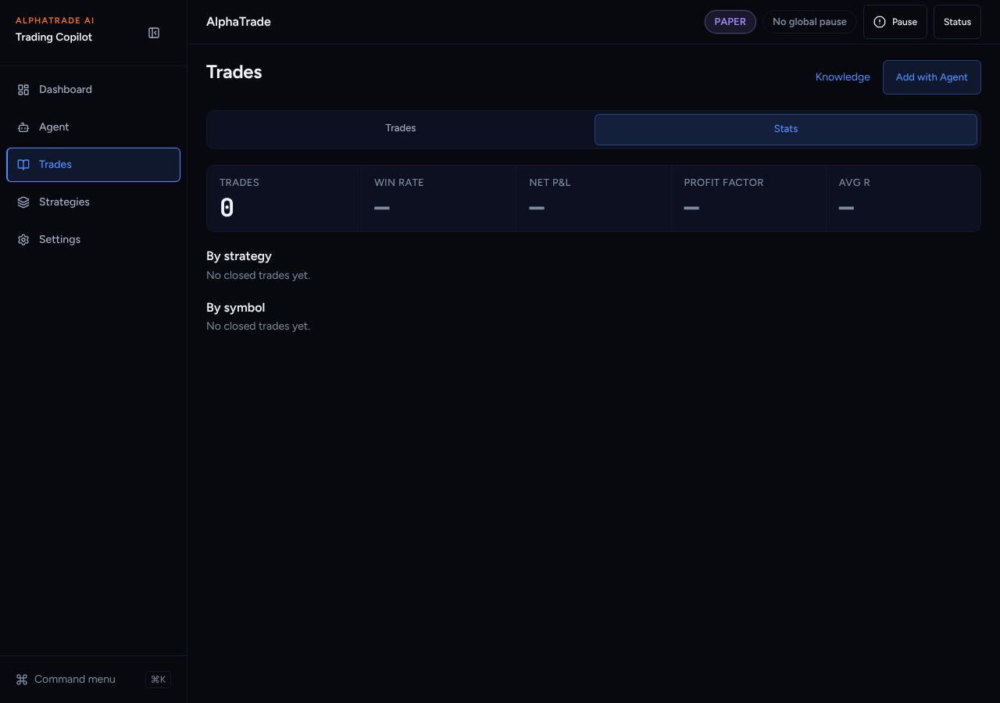
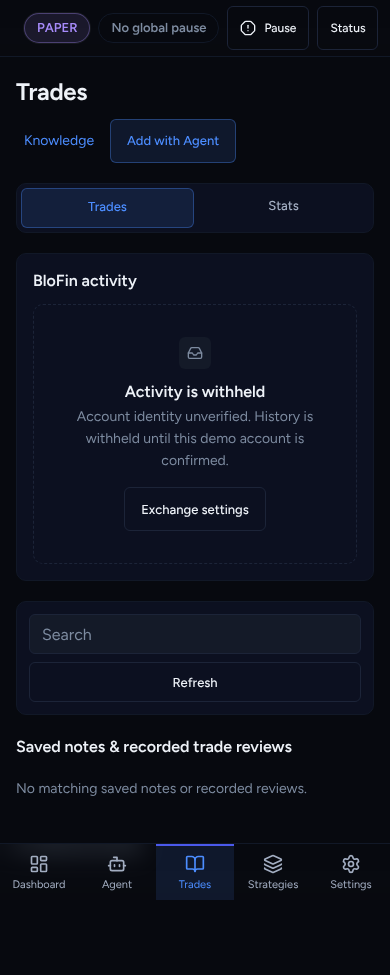

# UI overhaul B5a: Trades / Stats tabs, Knowledge on its own

Agent: Claude Code · Date: 2026-10-27 · Status: Done (PR open, not merged)
Plan: `docs/plans/2026-10-26-ui-overhaul-plan.md`, item **B5a**.
Stacked on B4 (#358).
Scope: frontend only. `JournalTradeScreen.tsx` (touched by #350) is not changed.

## What changed

- **`/journal` is "Trades".** Its h1 and sidebar label are "Trades" (the
  sidebar and mobile tab were "Journal & Knowledge" / "Journal").
- **URL tabs.** New `components/ui/link-tabs.tsx`: links with `aria-current`,
  so each tab has its own URL. The tabs are Trades (`/journal`) and Stats
  (`/journal?tab=stats`). They replace the hand-built Journal | Knowledge tab strip.
- **Stats tab** (new `components/journal/TradeStats.tsx`). It reads the
  existing `GET /journal/statistics`:
  - Overall: Trades · Win rate · Net P&L · Profit factor · Avg R.
  - By strategy and by symbol: trades, win %, and signed, coloured net P&L.
  - Missing values show "—". A failed read shows "Stats unavailable.", never zeros.
  - The Stats tab skips the trade-list reads.
- **`/knowledge` stands alone.** It has its own h1 "Knowledge" and no Journal
  tab. Its internal links point at `/knowledge?…`.
- **Redirects.**
  - `/journal?tab=knowledge…` → `/knowledge…` (`next.config` with a `has` query
    match; the rest of the query is kept).
  - `/journal/statistics` → `/journal?tab=stats` (the page's own `redirect()`;
    it used to go to `/`).
  - The B1 registry now understands query-matched redirects. Plain `/journal`
    stays a page.
- **Interim Knowledge link.** The Trades header has a "Knowledge" link until
  B6 gives Knowledge its own sidebar item.

## Decisions taken without asking

- **The sidebar label changed in this slice, not in B6.** Every primary page's h1
  matches its sidebar label (`e2e/simplified-ui-smoke.spec.ts`), so "Trades"
  needed both. The Dashboard link reads "Open Trades". The Help page entry
  reads "Trades & Knowledge".
- **Stats uses the existing statistics endpoint.** No backend change. Amounts
  have no currency in that response, so none is shown. The unit is not invented.
- **Agent links are not edited** (`SavedReceipt.tsx` still links
  `/journal?tab=knowledge…`). The redirect covers them, and the agent files stay
  clear of #350's area.
- **Playwright specs updated** for the label: `simplified-ui-smoke`,
  `decision-workflow`, `final-workspaces`, `webkit-iphone-audit`.

## Acceptance criteria (plan B5a)

- [x] vitest for tabs: links, `aria-current` and the URL per tab; the Stats
      content; Stats skips list reads; unavailable is honest.
- [x] vitest for redirects: the registry checks `tab=knowledge` → `/knowledge`
      (query only) and `/journal/statistics` → `/journal?tab=stats`; the page
      test checks the new target.
- [x] Knowledge is split out (its own h1, no Journal tab strip).

## Test evidence

From `frontend/`:

- `npx vitest run src/components/layout src/components/journal src/lib "src/app/(app)/journal" "src/app/(app)/knowledge" "src/app/(app)/strategies" src/components/dashboard`
  → 63 files, 600 passed. Then with the new tab tests,
  `JournalNativeActivity.test.tsx` → 5 passed.
- Full Playwright on a production build of the stack tip (B1 → B5a), chromium,
  fresh mock backend → **58 passed, 14 skipped (staging-only), 0 failed**.
- `curl` on the build: `/journal?tab=knowledge&category=rules` → 307 to
  `/knowledge?tab=knowledge&category=rules`.
- eslint → clean (one existing warning in an untouched spec). `tsc --noEmit` →
  clean. `next build` → OK.

## Screenshots

Production build, fresh paper user (honest empty states).

| Before (main) | After |
| --- | --- |
|  |  |
|  |  |

Stats tab: .
Phone: .

## Next steps

Griller review. Then B5b (New demo order sheet).
