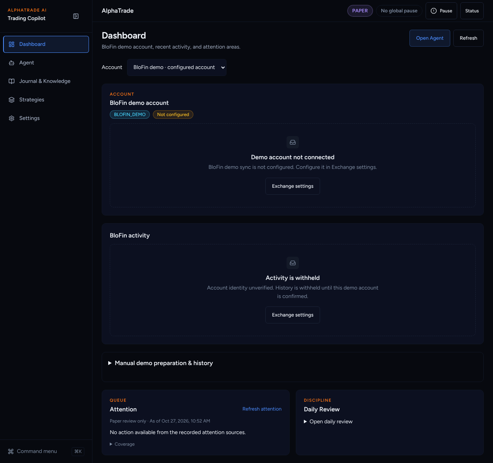
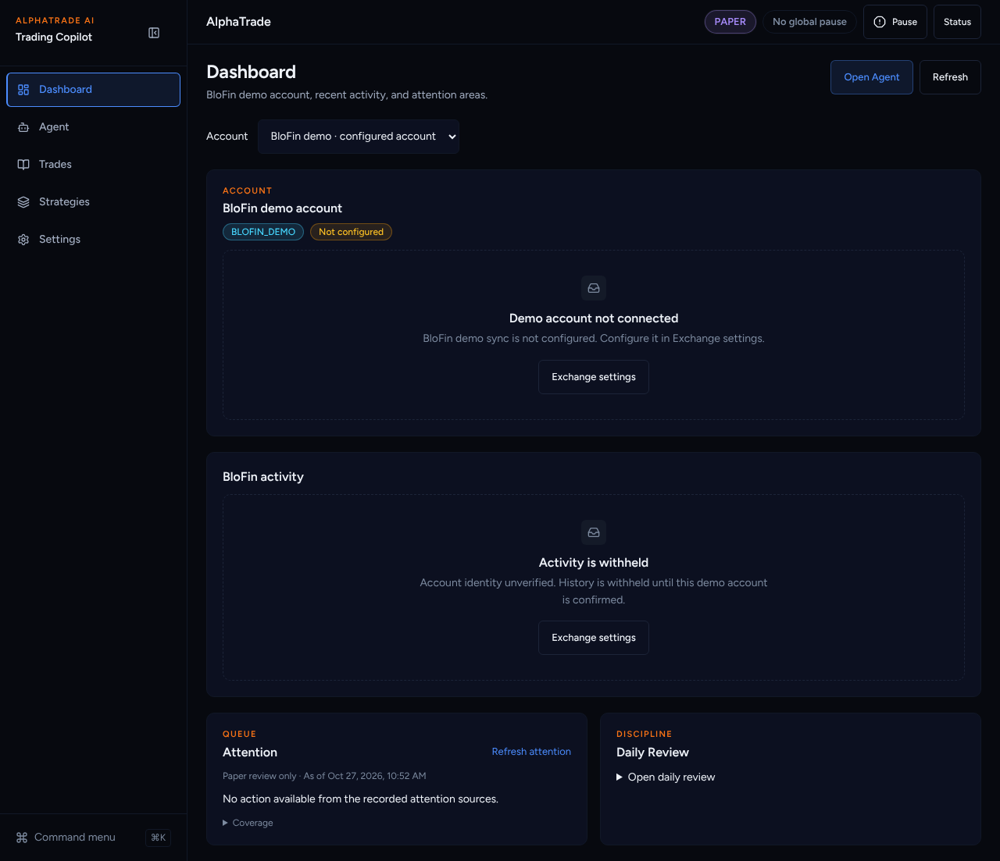
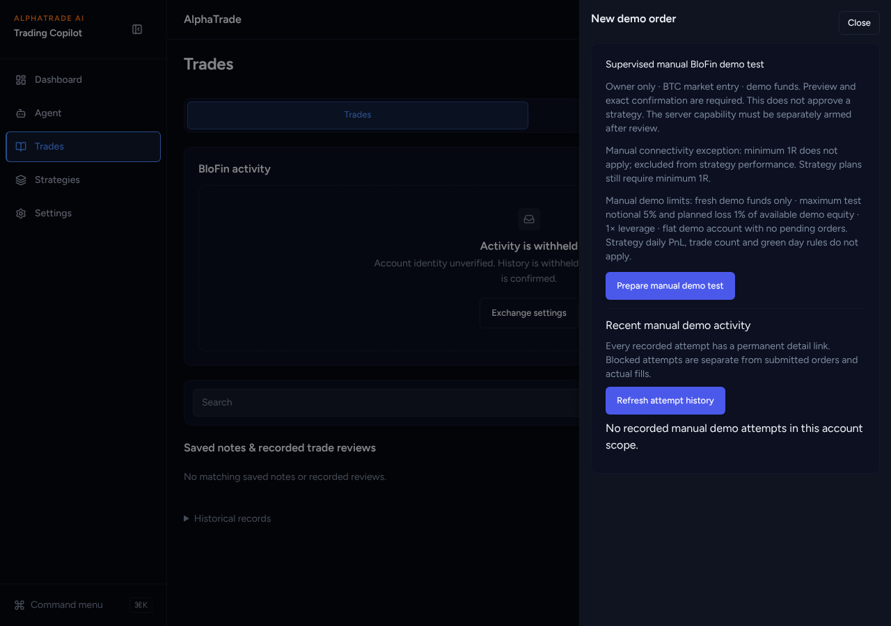
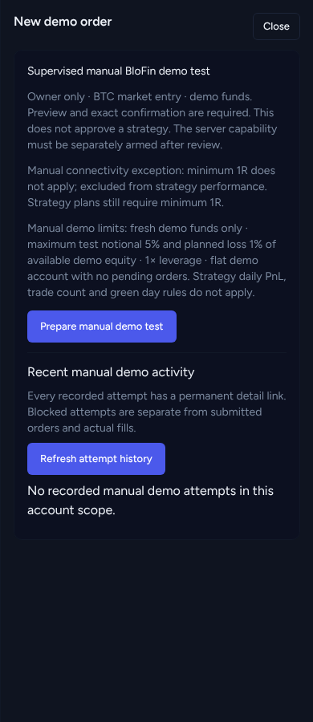

# UI overhaul B5b: New demo order on Trades

Agent: Claude Code · Date: 2026-10-27 · Status: Done (PR open, not merged)
Plan: `docs/plans/2026-10-26-ui-overhaul-plan.md`, item **B5b**.
Stacked on B5a (#360).
Scope: frontend only. `ManualDemoTest.tsx` and its tests are unchanged.

## What changed

- **Trades header gets "New demo order"** (new `components/journal/NewDemoOrder.tsx`).
  It opens a right-hand `Sheet` titled "New demo order" that holds the existing
  `ManualDemoTest` flow unchanged: prepare → preview → exact confirmation, plus
  the recent manual demo attempts. Escape or Close closes it; focus is trapped
  while it is open.
- **Dashboard** loses the "Manual demo preparation & history" disclosure and
  the `ManualDemoTest` import.
- `e2e/manual-demo-recovery.spec.ts` now opens `/journal` and clicks "New demo
  order". The rest of the spec is unchanged.

## Decisions taken without asking

- **The button shows on both Trades tabs** (Trades and Stats), because it is in
  the shared header. It does not show on Knowledge.
- **The sheet mounts the flow only while open**, so the Trades page does not read
  manual demo state until asked.
- **The flow's own copy stays.** The safety and limit text inside
  `ManualDemoTest` is long, but the plan's acceptance criteria require that flow
  and its tests to stay unchanged. Trimming it is a Track C copy item.

## Acceptance criteria (plan B5b)

- [x] The manual demo flow tests pass unchanged (`ManualDemoTest.test.tsx`,
      `ManualDemoHistory.test.tsx`; no edits to those files).
- [x] The Dashboard no longer has the flow (`app/(app)/page.test.tsx`).
- [x] "New demo order" opens the flow in a sheet (`NewDemoOrder.test.tsx`).

## Test evidence

From `frontend/`:

- `npx vitest run src/components/journal "src/app/(app)/page.test.tsx" "src/app/(app)/knowledge" src/components/dashboard src/components/settings/ManualDemo*`
  → 17 files, 147 passed.
- Playwright on a production build of this branch (chromium, mock backend):
  `manual-demo-recovery`, `dashboard-demo-account`, `workspace-redesign`,
  `simplified-ui-smoke`, `native-activity` → 10 passed.
- eslint → clean. `tsc --noEmit` → clean. `next build` → OK.

## Screenshots

Production build, fresh paper user.

| Before: Dashboard on main | After: Dashboard |
| --- | --- |
|  |  |

The sheet on Trades: .
Phone: .

## Next steps

Griller review. B5c (Trades table) waits for A7 (BloFin journal import), as the
plan says. Then B6 (sidebar).
