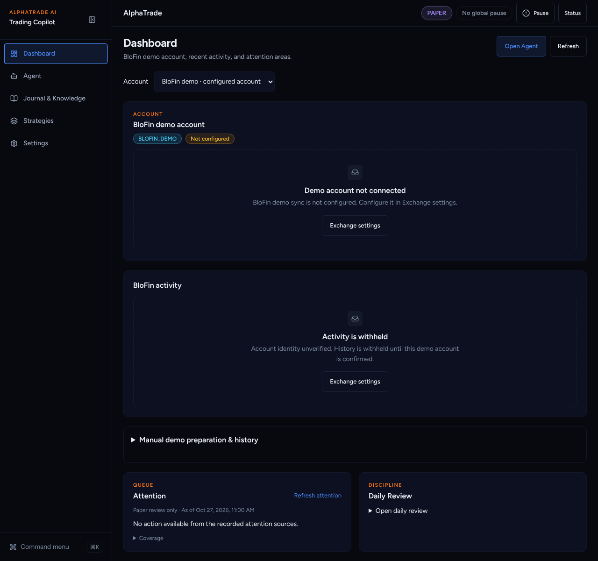
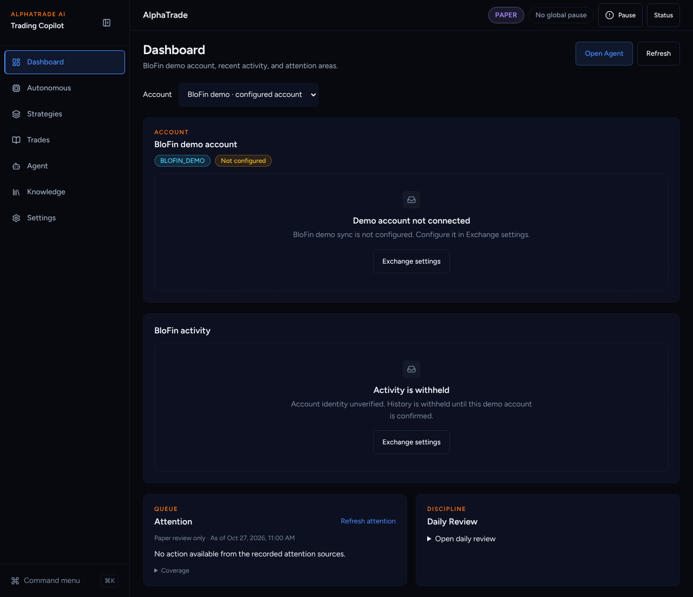
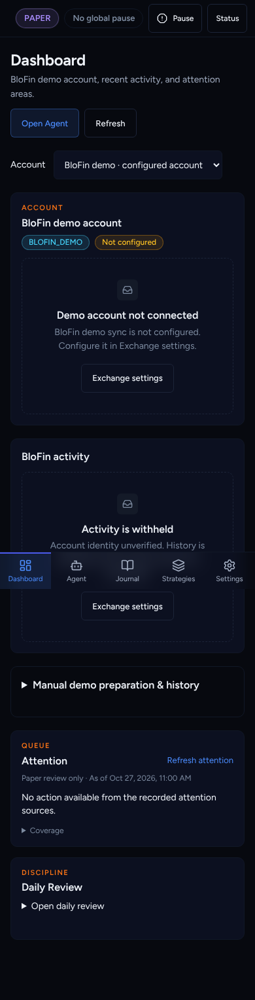
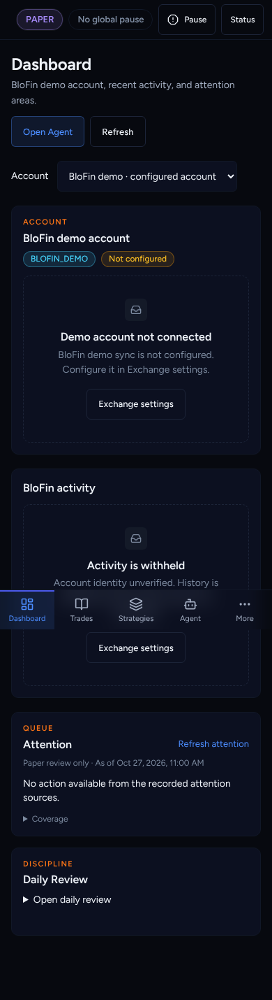
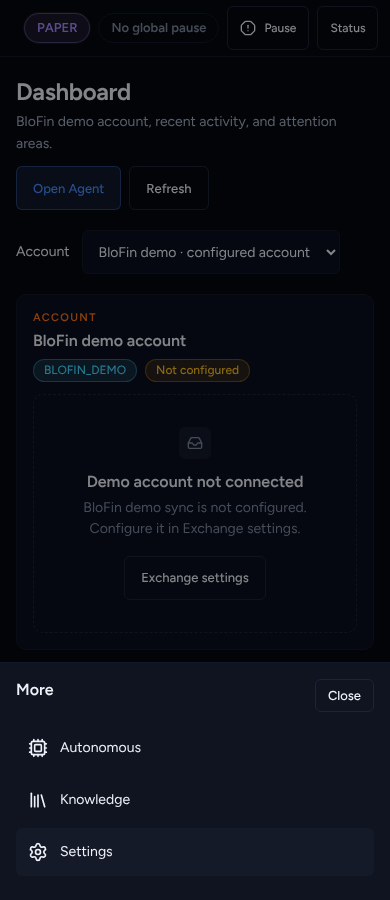

# UI overhaul B6: Seven-item sidebar, phone bar with More

Agent: Claude Code · Date: 2026-10-27 · Status: Done (PR open, not merged)
Plan: `docs/plans/2026-10-26-ui-overhaul-plan.md`, item **B6**.
Stacked on B5b (#361).
Scope: frontend only.

## What changed

- **Sidebar (7):** Dashboard · Autonomous · Strategies · Trades · Agent ·
  Knowledge · Settings (`PRIMARY_DESTINATIONS`).
- **Phone bar:** Dashboard · Trades · Strategies · Agent · **More**. More opens a
  bottom `Sheet` with Autonomous, Knowledge and Settings. The More button is
  marked (`data-active`) when the current page belongs to one of those, so the
  bar always shows where you are.
- **Which item lights up:**
  - `/autonomous` and the old `/risk*` URLs → **Autonomous** (was Strategies).
  - `/knowledge` and `/lessons*` → **Knowledge** (was Journal).
  - `/journal*`, `/learning-analytics`, `/coaching` → Trades.
  - Everything else is unchanged.
- The interim "Knowledge" link in the Trades header (added in B5a) is gone.
- The command menu lists the seven destinations first.

## Decisions taken without asking

- **Order follows the plan's sitemap table.** The phone bar uses the plan's 4 + More.
- **`/lessons` belongs to Knowledge.** Help copy says Knowledge holds Lessons.
- **More highlights instead of a hidden `aria-current`.** A link inside a
  closed sheet cannot be current, so the button carries `data-active` and the
  current link inside the sheet carries `aria-current`.
- **Icons:** Autonomous `Cpu`, Knowledge `Library` (lucide).
- **Dead code** (`MobileMoreNav.tsx`, `nav-items.ts`) is left. Deleting files
  needs Sofien's OK.
- **Playwright specs updated** for 7 / 4+More: `simplified-ui-smoke` (now
  walks all 7 destinations, opening More on the phone), `final-workspaces`,
  `workspace-redesign`, `notification-settings-v2`, `decision-workflow`,
  `blofin-repair`, `webkit-iphone-audit`.

## Acceptance criteria (plan B6)

- [x] Navigation-config tests: 7 destinations in order; phone 4 + More covering
      all 7.
- [x] One `isPrimaryDestinationActive` case per route, 36 in all: every primary
      route, their sub-routes, every redirected (old) route (`/risk*`,
      `/watchlist`, `/audit`, `/exchange`, `/coaching`, `/journal/statistics`,
      `/strategies/detections`, `/settings/advanced`), and deep links (setups,
      candidates, backtests, manual-demo, paper-validation, strategy-lab).
      Each lands on exactly one destination.
- [x] `isNavLinkActive` boundary cases. Path-boundary tests (`/autonomous-old`,
      `/riskier`, …).
- [x] AppShell tests for the phone bar, the More sheet and highlighting.

## Test evidence

From `frontend/`:

- `npx vitest run src/components/layout src/components/journal src/lib "src/app/(app)"`
  → 113 files, 945 passed.
- Full Playwright on a production build of the stack tip (B1 → B6), chromium,
  fresh mock backend → **58 passed, 14 skipped (staging-only), 0 failed**.
  - An earlier run on the same build had 2 failures. `blofin-repair` was a real
    spec mismatch: on the phone, Settings sits behind More; the spec was fixed.
    The `readiness-validation` Knowledge deep link passed alone (4/4) and in the
    fresh full run.
  - A third run on a reused backend hit 429 rate limits (environment).
- eslint → clean (one existing warning in an untouched spec). `tsc --noEmit` →
  clean. `next build` → OK.

## Screenshots

Production build, fresh paper user.

| Before (main) | After |
| --- | --- |
|  |  |
|  |  |

The More sheet on a phone: .

## Next steps

Griller review. Track B is done apart from B5c, which waits for A7. Next are
Track V (B7a–c) and Track C (C1a, C2).
