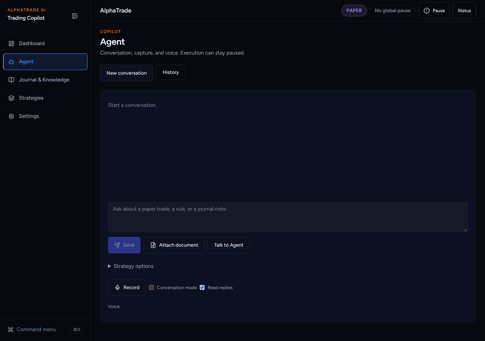
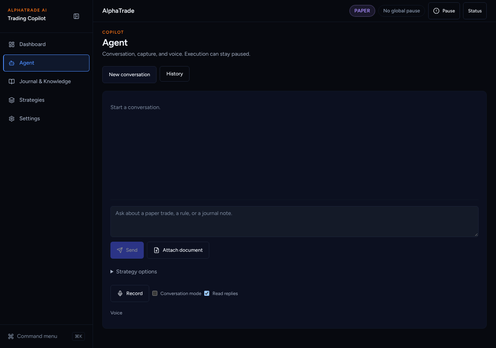
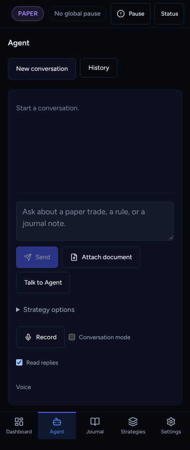
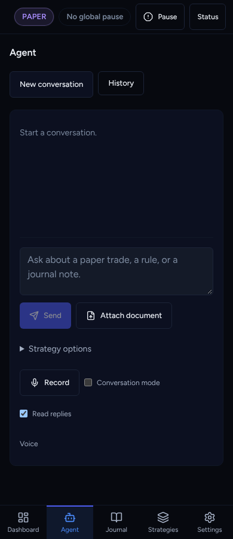

# UI overhaul B7b: Voice UI (Track V)

Agent: Claude Code · Date: 2026-10-27 · Status: Done (PR open, not merged)
Plan: `docs/plans/2026-10-26-ui-overhaul-plan.md`, item **B7b** (plan §5, items 3–6).
Branch from `main`; independent of B7a. Scope: frontend only. Track V needs
Griller's separate security review (K2).
`AgentWorkspace.test.tsx` and `AgentMessageContent.tsx` (#350) are **not touched**.

## What changed

- **Availability before the click** (§5.4). `RealtimeVoiceControls` reads
  `GET /agent/voice/config` on mount through the new `api.agent.voiceConfig()`.
  Voice off → the "Talk to Agent" button is hidden. Unreadable → today's
  behaviour (the button explains on click).
- **One mic** (§5.6). `AgentWorkspace` hides browser dictation ("Record") only
  when live voice is known to be available. Otherwise Record stays as the
  fallback mic. Before, both showed at once.
- **Reason codes kept** (§5.5). New `lib/voice/voice-reasons.ts` maps server
  codes to plain text:
  - Off: "Voice is off."
  - Not set up: "Voice is not set up."
  - Daily or monthly limit: "Daily / Monthly voice limit reached."
  - Budget: "Voice budget used up."
  - Turn limit: "Turn limit reached for this voice session."
  - Time limit: "Time limit reached for this voice session."

  The controller uses it for the config refusal and for `session.error`. Before,
  every failure became one generic line. Unknown codes keep the previous text.
- **Limit reached state.** The snapshot carries `limit: true` for budget,
  quota, turn and time caps. The alert reads "Limit reached · …" in amber.
- **Countdown and turns left.** The status line reads "GPT Live · Listening ·
  2:41 left · 4 turns left". The time is counted from `session.ready` using the
  config's `maximum_seconds` (capped at 300 as before). Turns count down on each
  accepted turn, using `maximum_turns`.
- **Worklet from `/public`** (§5.3). `public/voice/capture-worklet.js` replaces
  the `blob:` URL, so the AudioWorklet loads under `script-src 'self'`. The CSP
  is not loosened.

## Decisions taken without asking

- **"Unavailable" stays `state: "error"` plus a `limit` flag**, not a new
  state value. The existing controller tests expect `state: "error"` for an
  unavailable start, and the plan requires them to pass unchanged.
- **The availability read goes through `@/lib/api`**, not the generated client
  directly. `AgentWorkspace.test.tsx` (#350's file) mocks `@/lib/api` and counts
  `fetch` calls exactly, so this keeps that file untouched and passing.
- **No reset time is claimed.** The plan's example "resets 00:00" depends on
  quota windows the client cannot verify, so the text says only which limit was
  reached.
- **Voice stays off on staging until B7d.** No env, flag or receipt is set here.

## Acceptance criteria (plan B7b)

- [x] vitest for every state: off and hidden, available, unreadable, signed
      out, listening with countdown and turns, limit reached vs other error;
      controller reason text at start and on `session.error`; limit flag;
      countdown from readiness; turns decrement; reset on end.
- [x] The existing controller and audio tests pass unchanged (107 in
      `src/lib/voice` before the new cases were added).
- [x] Worklet served same-origin; production CSP has `'self'` and no `blob:`
      (`capture-worklet.test.ts`).

## Test evidence

From `frontend/`:

- `npx vitest run src/lib/voice` before the new tests → 107 passed (existing
  controller and audio tests unchanged).
- `npx vitest run src/lib/voice src/components/agent` → 13 files, **237 passed**.
  This includes the untouched `AgentWorkspace.test.tsx`.
- `npx vitest run src/lib/voice/capture-worklet.test.ts` → 2 passed.
- Production build: `curl /voice/capture-worklet.js` → `200 application/javascript`.
- Full Playwright on a production build of this branch (chromium, fresh mock
  backend) → 57 passed, 14 skipped, 1 failed. The failure is
  `readiness-validation` "deep-link matrix". Its page shows the **Sign in**
  screen because the shared e2e session was gone. It fails the same way on
  other branches now and then, and passes when run alone (4/4 earlier). This is
  session isolation in the existing suite, not voice. CI runs Playwright with
  `retries: 1`. Not fixed here.
- eslint → clean. `tsc --noEmit` → clean. `next build` → OK.

## Screenshots

Production build, mock backend (voice is off there).

| Before (main): two voice controls | After: one mic |
| --- | --- |
|  |  |

Phone:  .
The live states (countdown, limit) need a running GPT Live session, which needs
B7d (env and receipt on staging). The unit tests cover them.

## Next steps

Griller security review (Track V). Sofien: B7d env checklist (§5.2). Then B7c.
