# 1. Summary

**Question.** Does an SFP at real higher-timeframe levels (previous 4h, daily, weekly and monthly highs and lows) have an edge on BTC, and on ETH, ZEC, TAO and HYPE?

**Answer: not one we can trade.** None of the 12 versions fixed in advance passed the gate. Every one of them lost on BTC in the blind year (November 2025 to November 2026).

- **The default HTF SFP loses everywhere.** 15m chart, previous daily and weekly levels, market entry, wide stop: −0.25R per trade on BTC in the design years (235 trades) and −0.40R in the blind year (114 trades). The other four coins lost too.
- **One version looked good on BTC in the design years and did not hold up.** 1h chart, daily and weekly levels with a second level within 0.2% (confluence ≥ 2), a limit order at the swept level, wide stop: +0.29R per trade on 121 BTC trades in the design years (both design years positive), then **−0.18R on 53 BTC trades in the blind year**. This was the pre-registered primary version (V05).
- **Across the 882 settings explored on the design years,** only 1 in 10 BTC settings made money, and the best t-stat was 1.8. With that many tries, that is what luck alone produces. The blind year confirmed it.
- **Why trades lose** (step 1, the default on BTC): in 45% of losses the level broke for real, in 32% the trade reached +1R and came back to the stop before TP2, in 14% the stop was hunted and price then reversed, in 10% price went nowhere. Fees were never the main cause with the wide stop.
- **What helped a little in the design years:** the 1h chart rather than 15m, the wide stop (wick + max(0.7%, 1 ATR)), and requiring two levels together (confluence; on BTC, ETH and TAO only). **What did nothing:** equal highs/lows, keeping levels alive until swept, the volume filter, same-candle reclaim, and the alternative TP2.

**Recommendation:** keep SFP demo orders paused. Do not build the per-strategy risk setting for SFP yet. If round 2 goes ahead, it should test new ideas (volume profile, anchored VWAP, an HTF trend filter), not tune this round's settings, and it should be scored again on data the variants have not seen (section 5).

All results are in **R** (one R is the amount risked on a trade), after fees, slippage and funding, on Binance USD-M prices. Times are Tunis time (UTC+1).

# 2. How the SFP fails (step 1)

**The default tested here:** BTC, design years (entries 1 November 2023 to 31 October 2025), 15m execution chart, previous daily and weekly highs and lows, market entry at the next open after the reclaim close (entry a), stop beyond the wick + max(0.7%, 1 ATR14) (stop b), default exits (TP1 15% at 1R, TP2 50% at the next level, TP3 20% at the one after, 15% runner on a 5-candle trail, no break-even). The live bot's SFP is the same coin and years, its own detector and exits (section 6).

| Version | Trades | Per month | Win rate | R per trade | Net | t-stat | Max drawdown | Worst losing streak | Green months |
|---|---|---|---|---|---|---|---|---|---|
| HTF default | 235 | 9.8 | 25% | −0.25R | −59.5R | -2.38 | −71.2R | 17 | 9/24 |
| Live bot SFP (15m) | 10 | 0.4 | 30% | −0.42R | −4.2R | -1.04 | −4.6R | 3 | 2/24 |

- **The HTF default lost 0.25R per trade** over 235 trades (−59.5R). Even with no costs at all it would have lost 0.08R per trade; fees and slippage took about 0.17R per trade more (funding added +0.01R).
- 466 signals: 210 came while a BTC trade was already open (one position per coin) and 21 were refused by the reward-to-risk check, leaving 235 trades.
- **The live bot's SFP barely trades on BTC:** 332 signals in the two design years, 322 of them (97%) refused by the reward-to-risk check, because its target (the nearest opposite level) is usually closer than its stop. The 10 trades it took lost 4.2R.

**Why each loss lost** (every losing trade, one reason each; definitions in section 6):

| Loss reason | HTF default | | Live bot SFP | |
|---|---|---|---|---|
| Level broke for real | 79 | 45% | 2 | 29% |
| Stop hunted, then reversed (wick retest) | 24 | 14% | 4 | 57% |
| Target too far: reached +1R, then back to the stop | 57 | 32% | 0 | 0% |
| Target too close / R:R refused (refused before entry, not traded) | (21 signals) | | (322 signals) | |
| Fees too large vs the stop | 0 | 0% | 0 | 0% |
| Chop, no follow-through | 17 | 10% | 1 | 14% |
| Other | 0 | 0% | 0 | 0% |
| **All losses** | **177** | 100% | **7** | 100% |

- **Level broke for real** is the largest group (45%): price swept the level, closed back inside, then went through it anyway, well past the stop.
- **Target too far** (32%): the trade reached +1R (TP1 filled), then came back to the stop before TP2. With no break-even move, these still lose about 0.7 to 0.9R.
- **Stop hunted, then reversed** is only 14%: a wider stop would not have saved most losses.
- **Fees** were never the main reason with the wide stop (median stop distance 1.1%). They matter in aggregate (about 0.17R per trade with slippage) but no single loss is explained by them alone, and the default loses even before costs.
- **R:R refused:** these are not losses, because a refused signal is never traded. Replayed anyway, the 21 refused signals of the HTF default would have made +0.06R per trade (+1.2R in total): refusing them cost nothing.

**The gallery.** 13 losses (picked in proportion to the reasons above and spread over the two years) and 5 wins (spread over the two years). Every chart shows the level (purple), the sweep wick (purple triangle), the entry (dark arrow), the stop (red dashed), the targets (green dotted) and every exit (×, red for the stop or the trail). Losing charts run 24 hours past the stop, the window used to classify them. Times are Tunis time; the chart switches from 15m to 1h or 4h candles when a trade lasts more than two (or eight) days.

| Chart | Entry (Tunis) | Level | Side | Entry | Stop | Exits | R | Reason |
|---|---|---|---|---|---|---|---|---|
| [loss_01.png](sfp_r1_charts/loss_01.png) | 2023-11-02 04:00 | 1w high | short | 35,692.7 | 36,251.9 | 15% @ 35,134, 85% @ 36,252 | −0.72 | Target too far: reached +1R, then back to the stop |
| [loss_02.png](sfp_r1_charts/loss_02.png) | 2023-11-13 13:00 | 1d low | long | 36,837.5 | 36,453.0 | 100% @ 36,453 | −1.23 | Level broke for real |
| [loss_03.png](sfp_r1_charts/loss_03.png) | 2023-11-24 11:45 | 1w high | short | 37,680.0 | 38,315.4 | 100% @ 38,315 | −1.13 | Chop, no follow-through |
| [loss_04.png](sfp_r1_charts/loss_04.png) | 2024-01-28 02:30 | 1d high | short | 42,162.7 | 42,532.6 | 100% @ 42,533 | −1.25 | Stop hunted, then reversed (wick retest) |
| [loss_05.png](sfp_r1_charts/loss_05.png) | 2024-03-07 15:45 | 1d high | short | 67,257.3 | 68,470.0 | 100% @ 68,470 | −1.05 | Level broke for real |
| [loss_06.png](sfp_r1_charts/loss_06.png) | 2024-08-02 21:30 | 1d low | long | 62,520.0 | 61,575.9 | 100% @ 61,576 | −1.14 | Level broke for real |
| [loss_07.png](sfp_r1_charts/loss_07.png) | 2024-08-21 20:45 | 1d high | short | 61,147.4 | 61,828.8 | 15% @ 60,466, 85% @ 61,829 | −0.90 | Target too far: reached +1R, then back to the stop |
| [loss_08.png](sfp_r1_charts/loss_08.png) | 2024-11-29 03:15 | 1d high | short | 96,504.6 | 97,376.9 | 100% @ 97,377 | −1.23 | Level broke for real |
| [loss_09.png](sfp_r1_charts/loss_09.png) | 2025-01-28 05:45 | 1d high | short | 103,052.1 | 104,048.6 | 15% @ 102,056, 85% @ 104,049 | −0.88 | Target too far: reached +1R, then back to the stop |
| [loss_10.png](sfp_r1_charts/loss_10.png) | 2025-04-22 02:30 | 1d high | short | 88,355.8 | 89,472.0 | 100% @ 89,472 | −1.18 | Level broke for real |
| [loss_11.png](sfp_r1_charts/loss_11.png) | 2025-08-27 15:45 | 1d high | short | 111,863.6 | 113,356.5 | 100% @ 113,356 | −1.15 | Stop hunted, then reversed (wick retest) |
| [loss_12.png](sfp_r1_charts/loss_12.png) | 2025-10-16 10:45 | 1d low | long | 111,192.0 | 108,637.6 | 100% @ 108,638 | −1.09 | Level broke for real |
| [loss_13.png](sfp_r1_charts/loss_13.png) | 2025-10-30 20:45 | 1w low | long | 106,700.0 | 105,456.6 | 15% @ 107,943, 85% @ 105,457 | −0.95 | Target too far: reached +1R, then back to the stop |
| [win_01.png](sfp_r1_charts/win_01.png) | 2023-11-14 20:00 | 1w low | long | 35,242.4 | 34,165.8 | 15% @ 36,319, 50% @ 37,465, 20% @ 37,570, 15% @ 37,700 | +1.89 | win |
| [win_02.png](sfp_r1_charts/win_02.png) | 2024-05-21 01:30 | 1d high | short | 71,473.1 | 72,637.8 | 15% @ 70,308, 50% @ 66,010, 20% @ 65,836, 15% @ 65,525 | +4.50 | win |
| [win_03.png](sfp_r1_charts/win_03.png) | 2024-12-01 03:00 | 1d low | long | 96,164.8 | 95,422.5 | 15% @ 96,907, 50% @ 97,522, 35% @ 95,422 | +0.41 | win |
| [win_04.png](sfp_r1_charts/win_04.png) | 2025-05-31 01:30 | 1d low | long | 103,760.4 | 102,776.4 | 15% @ 104,744, 50% @ 106,266, 35% @ 102,776 | +0.84 | win |
| [win_05.png](sfp_r1_charts/win_05.png) | 2025-10-22 12:15 | 1d low | long | 107,929.5 | 105,615.7 | 15% @ 110,243, 50% @ 113,940, 20% @ 115,912, 15% @ 115,459 | +2.52 | win |

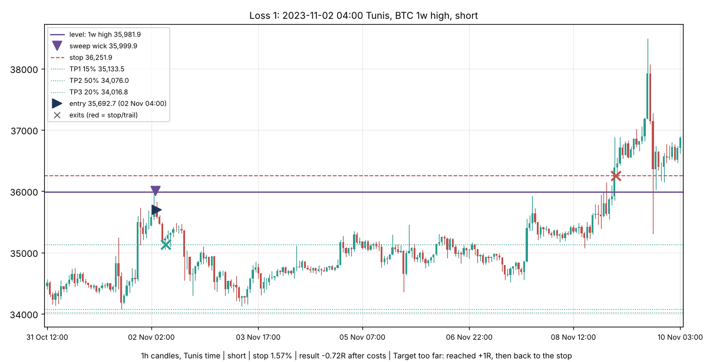

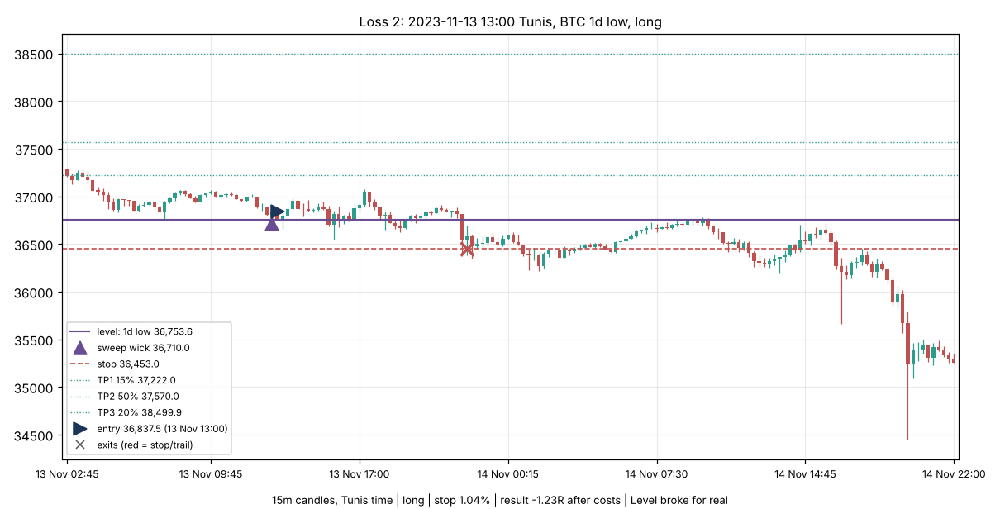

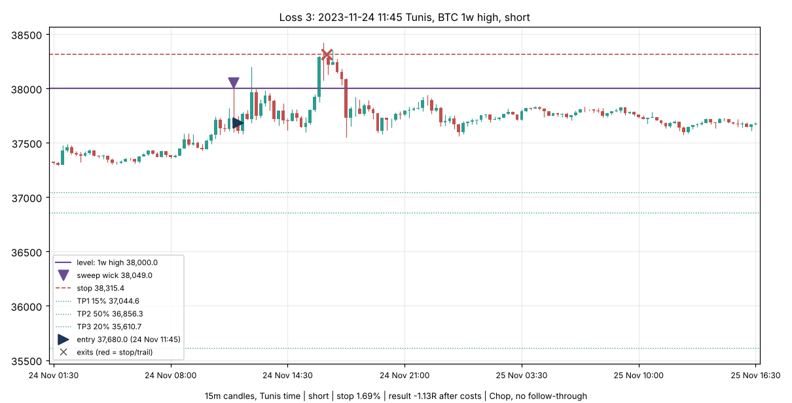

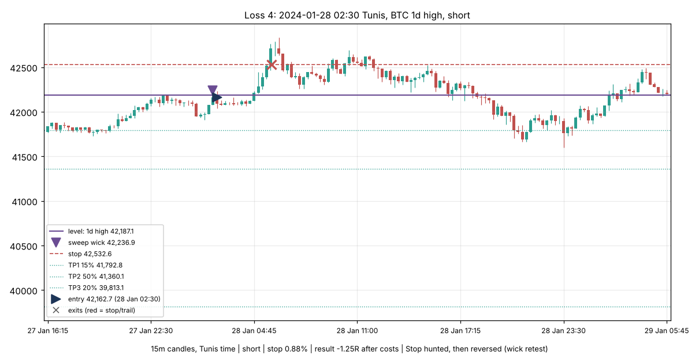

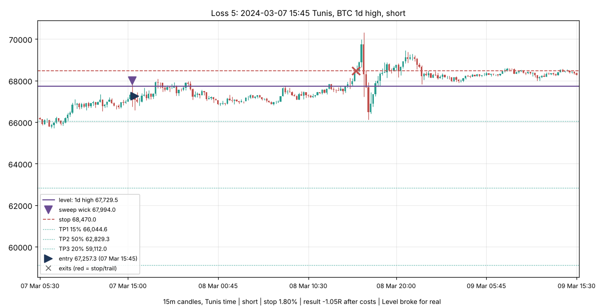

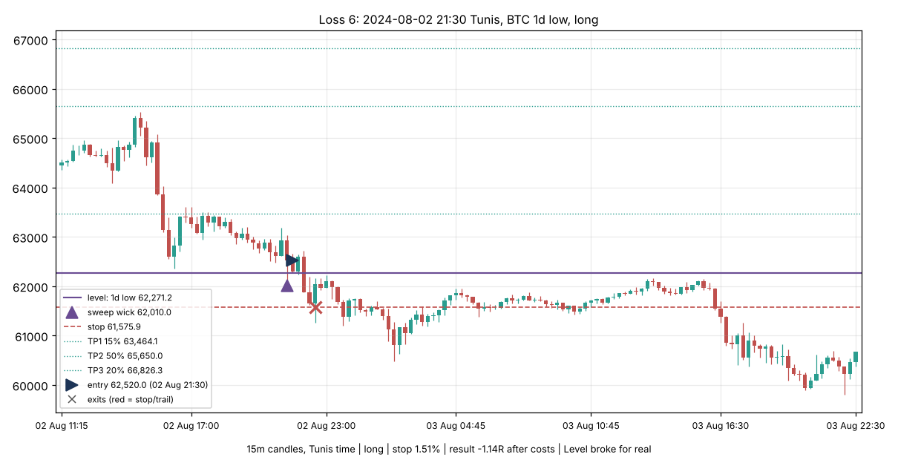

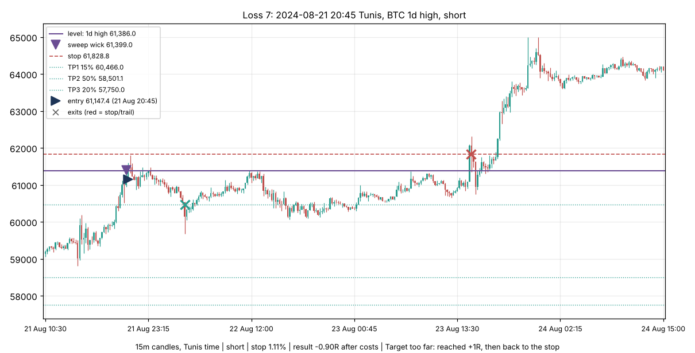

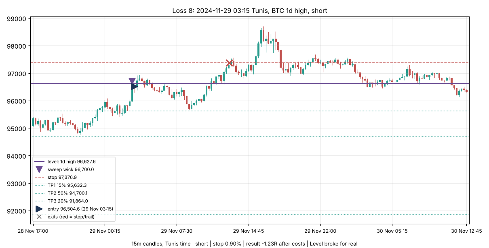

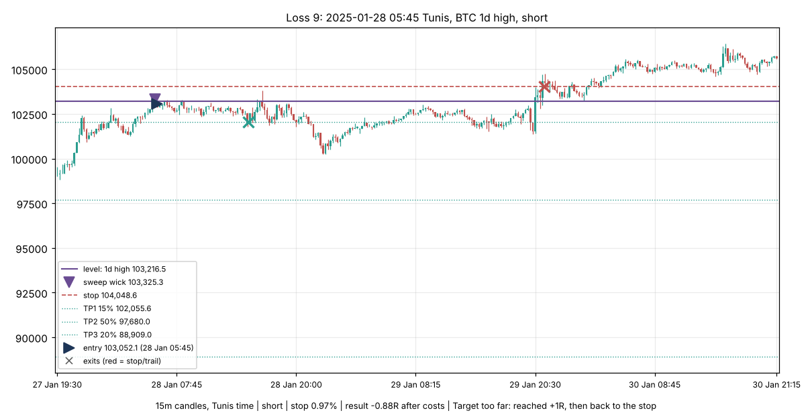

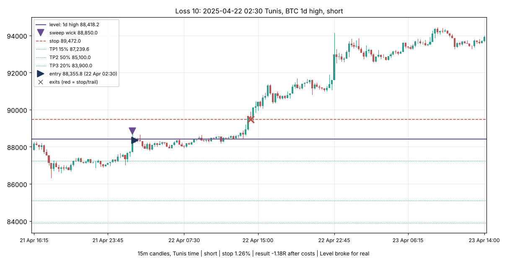

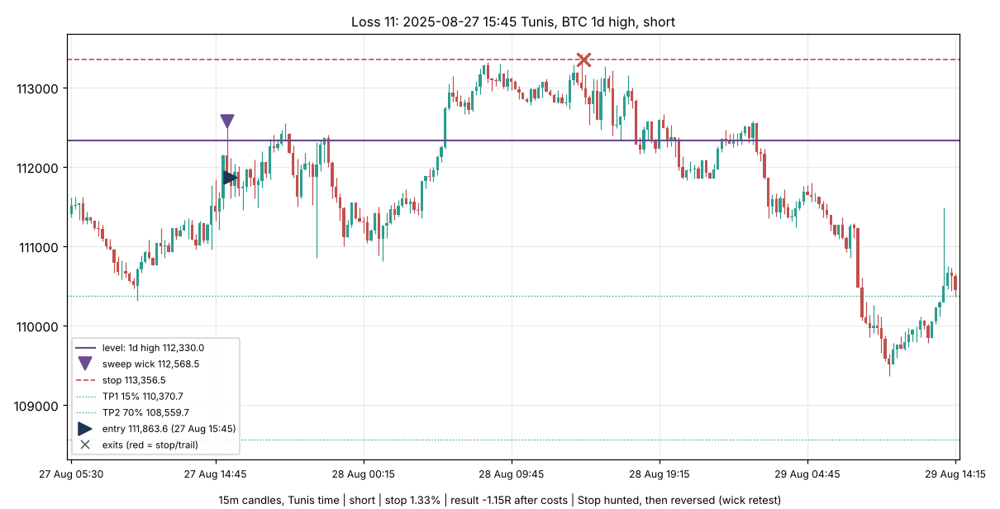

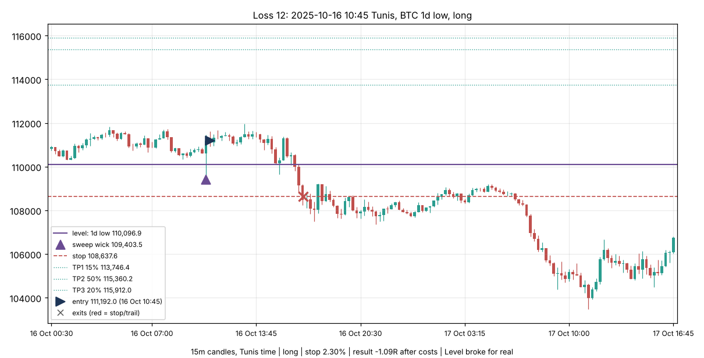

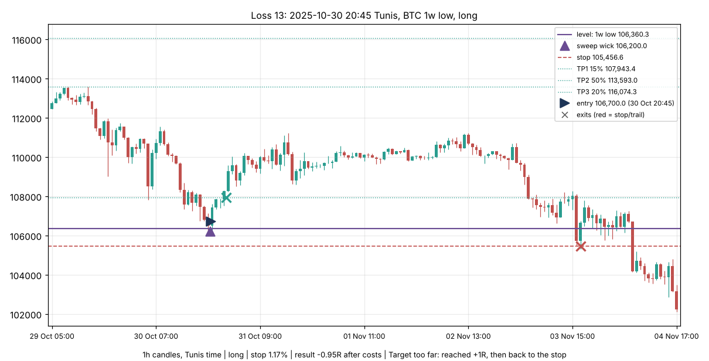

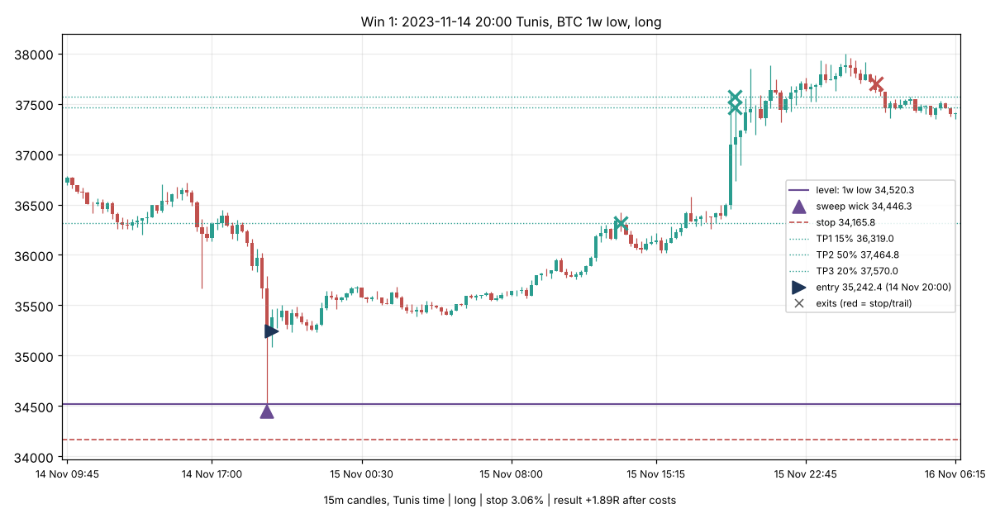

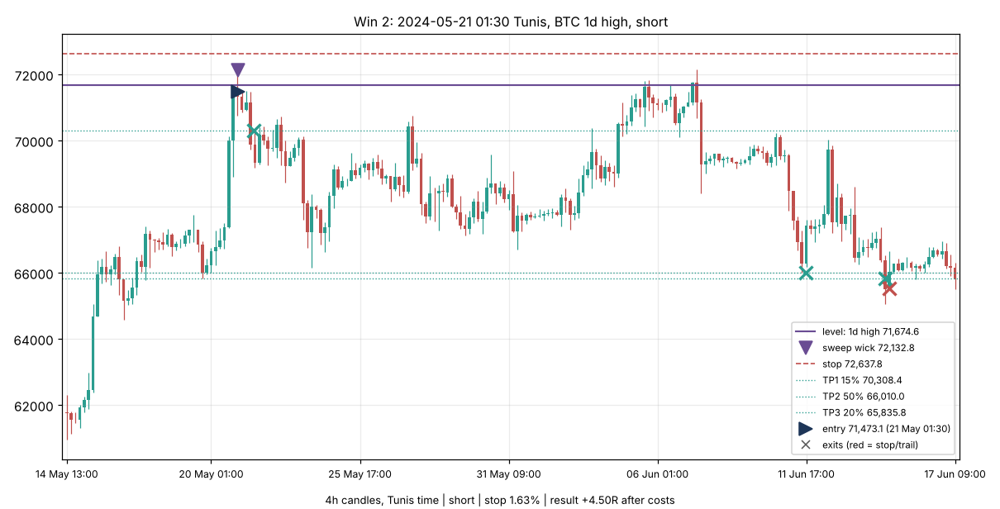

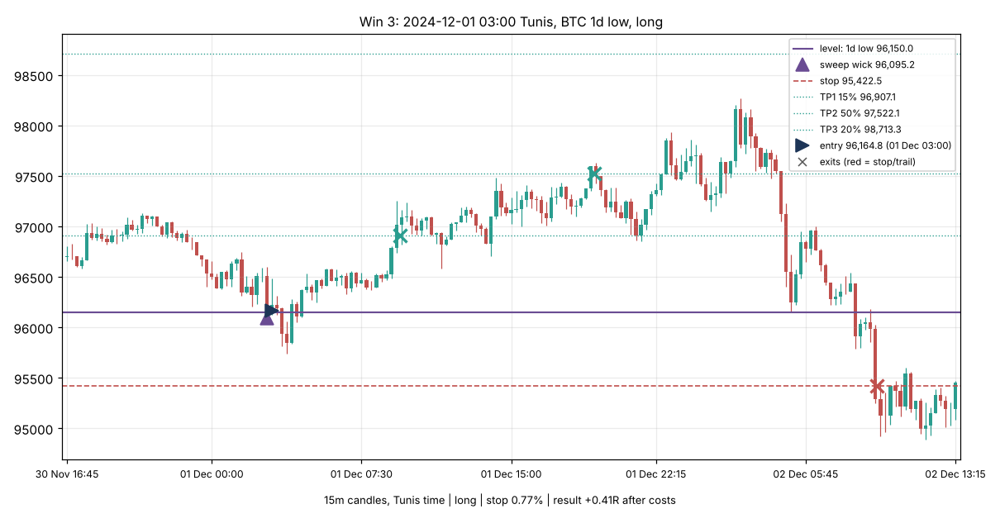

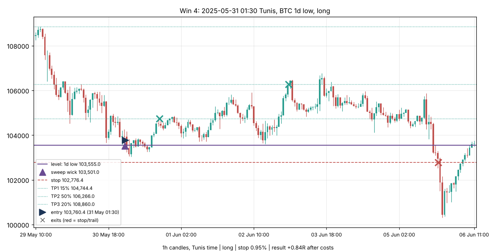

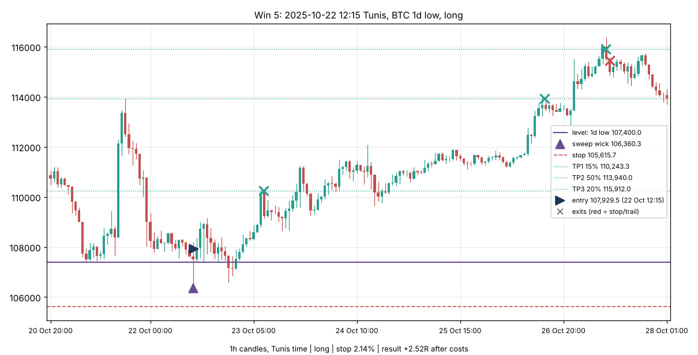


# 3. Exploration on the design years (step 2)

Entries from 1 November 2023 to 31 October 2025 only. The blind year was never read in this step (`explore.py` drops every signal outside the period).

**What was explored** (882 settings per coin):

- Stage A: execution chart (15m, 1h) × level set (4h; daily; weekly; monthly; daily+weekly; daily+weekly+monthly; all four) × entry (a, b, c) × stop (a, b, c). Previous-candle levels, reclaim on the sweep candle or the next one, default exits.
- Stage B: each stage-A setting with one change: levels stay alive until swept (up to 5 candles), equal highs/lows added, same-candle reclaim only, TP2 at the other side of the swept level's candle, volume ≥ 1.5× the 20-candle average, confluence ≥ 2.

**Average R per trade by choice** (stage A, settings with at least 30 trades; monthly levels alone gave too few trades):

| Choice | Option | BTC | ETH | ZEC | TAO | HYPE |
|---|---|---|---|---|---|---|
| Execution chart | 15m | −0.26 | −0.24 | −0.23 | −0.20 | −0.06 |
| Execution chart | 1h | −0.16 | −0.12 | −0.19 | −0.22 | −0.15 |
| Level set | 1M | n/a | n/a | n/a | n/a | n/a |
| Level set | 1d | −0.18 | −0.18 | −0.31 | −0.29 | −0.07 |
| Level set | 1d+1w | −0.21 | −0.16 | −0.28 | −0.30 | −0.07 |
| Level set | 1d+1w+1M | −0.20 | −0.18 | −0.29 | −0.27 | −0.09 |
| Level set | 1w | −0.41 | −0.26 | +0.23 | +0.08 | n/a |
| Level set | 4h | −0.14 | −0.20 | −0.18 | −0.14 | −0.13 |
| Level set | 4h+1d+1w+1M | −0.20 | −0.17 | −0.18 | −0.16 | −0.13 |
| Entry | a | −0.24 | −0.19 | −0.16 | −0.15 | −0.06 |
| Entry | b | −0.16 | −0.07 | −0.28 | −0.14 | −0.13 |
| Entry | c | −0.21 | −0.28 | −0.19 | −0.34 | −0.14 |
| Stop | a | −0.23 | −0.27 | −0.25 | −0.25 | −0.12 |
| Stop | b | −0.17 | −0.10 | −0.11 | −0.16 | −0.10 |
| Stop | c | −0.21 | −0.19 | −0.27 | −0.22 | −0.09 |

**Average change from adding one option** (R per trade, and the share of trades kept):

| Option added | BTC ΔR / trades | ETH ΔR / trades | ZEC ΔR / trades | TAO ΔR / trades | HYPE ΔR / trades |
|---|---|---|---|---|---|
| Naked levels (until swept, 5 candles) | +0.01R / 120% | +0.02R / 121% | −0.05R / 120% | −0.01R / 125% | −0.10R / 119% |
| Equal highs/lows | −0.00R / 101% | +0.00R / 101% | −0.00R / 100% | +0.00R / 100% | −0.00R / 100% |
| Same-candle reclaim only | −0.03R / 82% | +0.02R / 77% | −0.01R / 77% | −0.00R / 78% | +0.07R / 80% |
| TP2 at the swept candle's other side | +0.01R / 98% | −0.02R / 97% | −0.02R / 99% | +0.01R / 98% | +0.03R / 99% |
| Volume >= 1.5x | −0.02R / 82% | −0.01R / 80% | +0.01R / 68% | −0.04R / 67% | −0.13R / 61% |
| Confluence >= 2 | +0.08R / 52% | +0.12R / 39% | −0.09R / 39% | +0.12R / 33% | −0.05R / 45% |

**How many settings made money** (at least 40 trades in the two design years):

| Coin | Settings | Positive | Best t-stat |
|---|---|---|---|
| BTCUSDT | 577 | 57 | 1.82 |
| ETHUSDT | 630 | 111 | 1.96 |
| ZECUSDT | 634 | 26 | 0.62 |
| TAOUSDT | 611 | 39 | 1.12 |
| HYPEUSDT | 355 | 82 | 1.26 |

**Best BTC settings in the design years** (at least 40 trades), with the same setting on the other four coins:

| # | Setting | BTC trades | BTC R/trade | BTC t | other coins trades | other R/trade |
|---|---|---|---|---|---|---|
| 605 | 1h, 1d, entry c, stop b, confluence ≥2 | 119 | +0.32 | 1.82 | 345 | −0.18 |
| 767 | 1h, 1d+1w, entry c, stop b, confluence ≥2 | 121 | +0.29 | 1.68 | 348 | −0.20 |
| 821 | 1h, 1d+1w+1M, entry c, stop b, confluence ≥2 | 121 | +0.25 | 1.47 | 348 | −0.21 |
| 556 | 1h, 4h, entry c, stop c, volume 1.5x | 57 | +0.19 | 0.84 | 493 | −0.12 |
| 742 | 1h, 1d+1w, entry b, stop a, volume 1.5x | 64 | +0.17 | 0.82 | 217 | −0.18 |
| 580 | 1h, 1d, entry b, stop a, volume 1.5x | 61 | +0.16 | 0.75 | 192 | −0.22 |
| 796 | 1h, 1d+1w+1M, entry b, stop a, volume 1.5x | 65 | +0.15 | 0.72 | 219 | −0.21 |
| 819 | 1h, 1d+1w+1M, entry c, stop b, TP2 = candle range | 167 | +0.14 | 0.87 | 629 | −0.12 |
| 576 | 1h, 1d, entry b, stop a, naked levels | 114 | +0.13 | 0.83 | 437 | −0.21 |
| 765 | 1h, 1d+1w, entry c, stop b, TP2 = candle range | 180 | +0.13 | 0.81 | 652 | −0.12 |

**Notes**

- The best BTC settings share one shape: 1h chart, a limit order at the swept level, the wide stop, and a second level within 0.2%. On BTC this shape was positive in both design years. On the other four coins it lost.
- The 1h chart beat the 15m chart on BTC, ETH and ZEC. The wide stop beat the wick stop on every coin.
- The limit entry (c) only worked with the wide stop: on BTC and ETH, with the wick stop it was the worst entry. About 30% of the limit orders never filled (price did not trade back through the level within 6 candles).
- Equal highs/lows changed almost nothing: at 0.1% tolerance with nothing higher in between, they rarely add a level that the previous-candle levels do not already give.
- No setting had a t-stat above 2 on any coin. With hundreds of settings tried per coin, the best few are expected to look good by chance; that is why the blind year decides.

**The 12 frozen variants** (committed in `research/backtests/sfp_r1/frozen_variants.json` in commit `cebfacd`, before the blind run). V05 was named the primary version in advance. The list was chosen on a first exploration run; afterwards a look-ahead bug was found in the check that picks untaken target levels (it read the 1h candle still open at entry) and fixed in commit `be25c52`. Exploration and the blind run were then repeated with the same frozen list; the fix moved design-year results by 0.00R to 0.02R per trade and did not change which settings ranked best. All numbers in this report are from the corrected code. The "BTC, design years" column shows the corrected figures (the frozen file keeps the pre-fix ones).

| Id | Setting | Why it is in the list | BTC, design years |
|---|---|---|---|
| V01 | 15m, daily+weekly, market entry, wide stop | step-1 default (reference) | 235 trades, −0.25R |
| V02 | 1h, daily+weekly, market entry, wide stop | the default moved to 1h | 166 trades, −0.20R |
| V03 | 1h, daily+weekly, limit at the level, wide stop | best simple shape | 189 trades, +0.08R |
| V04 | 1h, daily+weekly+monthly, limit at the level, wide stop | adds monthly levels | 174 trades, +0.10R |
| V05 | 1h, daily+weekly, limit at the level, wide stop, confluence ≥ 2 | **primary** | 121 trades, +0.29R |
| V06 | as V05 with monthly levels | | 121 trades, +0.25R |
| V07 | 1h, daily only, limit at the level, wide stop, confluence ≥ 2 | | 119 trades, +0.32R |
| V08 | 15m twin of V05 | checks the execution chart | 111 trades, +0.01R |
| V09 | 1h, daily+weekly, confirmation entry, wick stop | best with the confirmation entry; good on ETH | 100 trades, +0.09R |
| V10 | as V09 with confluence ≥ 2 | | 69 trades, +0.04R |
| V11 | as V04 with TP2 at the swept candle's other side | the take-profit alternative | 167 trades, +0.14R |
| V12 | 1h, previous 4h levels, limit at the level, stop beyond the closed 4h sweep candle | Sofien's stop option c | 83 trades, +0.10R |

# 4. The frozen variants on the blind year (step 3)

Every variant was run once on both periods. Blind year = entries from 1 November 2025 to 25 November 2026.

**Overview** (trades / R per trade after all costs):

| Variant | BTC design | BTC blind | BTC by year (R/trade) | All five design | All five blind | Gate |
|---|---|---|---|---|---|---|
| V01 | 235 / −0.25R | 114 / −0.40R | −0.39 / −0.11 / −0.40 | 1103 / −0.22R | 546 / −0.31R | fail |
| V02 | 166 / −0.20R | 84 / −0.41R | −0.20 / −0.21 / −0.41 | 818 / −0.11R | 408 / −0.20R | fail |
| V03 | 189 / +0.08R | 104 / −0.27R | +0.15 / +0.01 / −0.27 | 864 / −0.08R | 445 / −0.12R | fail |
| V04 | 174 / +0.10R | 102 / −0.25R | +0.12 / +0.07 / −0.25 | 837 / −0.07R | 435 / −0.11R | fail |
| V05 | 121 / +0.29R | 53 / −0.18R | +0.23 / +0.35 / −0.18 | 469 / −0.07R | 243 / +0.07R | fail |
| V06 | 121 / +0.25R | 53 / −0.18R | +0.18 / +0.33 / −0.18 | 469 / −0.09R | 242 / +0.09R | fail |
| V07 | 119 / +0.32R | 56 / −0.25R | +0.14 / +0.50 / −0.25 | 464 / −0.05R | 262 / +0.07R | fail |
| V08 | 111 / +0.01R | 57 / −0.06R | −0.09 / +0.13 / −0.06 | 479 / −0.13R | 259 / −0.10R | fail |
| V09 | 100 / +0.09R | 43 / −0.27R | −0.09 / +0.27 / −0.27 | 466 / −0.12R | 269 / −0.09R | fail |
| V10 | 69 / +0.04R | 25 / −0.01R | −0.15 / +0.24 / −0.01 | 257 / +0.01R | 128 / +0.08R | fail |
| V11 | 167 / +0.14R | 102 / −0.29R | +0.24 / +0.03 / −0.29 | 796 / −0.06R | 495 / −0.09R | fail |
| V12 | 83 / +0.10R | 36 / −0.00R | +0.38 / −0.22 / −0.00 | 1172 / −0.15R | 760 / −0.02R | fail |

"BTC by year" = November to October for the two design years, then the blind year.

**Gate** (Sofien): positive in both periods; blind year ≥ 50 trades (BTC alone: ≥ 25 if all three years are positive); ≥ +0.15R per trade after costs; no coin above 50% of the profit. **No variant passed.**

- **BTC:** all 12 variants lost in the blind year. The best was V12 at −0.00R on 36 trades; the primary V05 lost −0.18R per trade (−9.5R on 53 trades).
- **All five coins:** V05, V06, V07 and V10 were slightly positive in the blind year (+0.07R to +0.09R per trade), but none reaches +0.15R. V05, V06 and V07 also lost in the design years and took most of their blind-year profit from TAO (V05: 76%, V07: 88%); V10 was flat in the design years (+0.01R) and took 63% of its blind-year profit from ZEC.
- The design-year winners on BTC reversed in the blind year; the design-year losers on the other coins turned slightly positive. That pattern is what noise looks like, not an edge.

**The primary variant V05 in full**:

| Coins | Period | Trades | Per month | Win rate | R per trade | Net | t-stat | Max drawdown | Worst losing streak | Green months |
|---|---|---|---|---|---|---|---|---|---|---|
| BTC | design | 121 | 5.0 | 36% | +0.29R | +35.2R | 1.68 | −12.9R | 12 | 18/24 |
| BTC | blind | 53 | 4.1 | 28% | −0.18R | −9.5R | -0.87 | −18.7R | 13 | 6/13 |
| Other four | design | 348 | 14.5 | 19% | −0.20R | −69.9R | -2.20 | −94.6R | 21 | 8/24 |
| Other four | blind | 190 | 14.6 | 28% | +0.14R | +26.5R | 0.99 | −13.2R | 12 | 10/13 |
| All five | design | 469 | 19.5 | 23% | −0.07R | −34.7R | -0.90 | −95.7R | 19 | 11/24 |
| All five | blind | 243 | 18.7 | 28% | +0.07R | +17.0R | 0.58 | −24.1R | 14 | 8/13 |

design net by coin: BTC +35.2R (100% of profit), ETH −16.0R (0% of profit), ZEC −13.8R (0% of profit), TAO −34.1R (0% of profit), HYPE −6.0R (0% of profit)

blind net by coin: BTC −9.5R (0% of profit), ETH +2.0R (8% of profit), ZEC +4.1R (15% of profit), TAO +20.2R (76% of profit), HYPE +0.3R (1% of profit)

The losses of V05 on BTC look the same in both periods; there were simply more of them in the blind year (38 of 53 trades lost, against 77 of 121 in the design years):

| Loss reason (V05, BTC) | Design years | Blind year |
|---|---|---|
| Level broke for real | 36 (47%) | 15 (39%) |
| Target too far: reached +1R, then back to the stop | 23 (30%) | 11 (29%) |
| Stop hunted, then reversed | 11 (14%) | 8 (21%) |
| Chop, no follow-through | 7 (9%) | 4 (11%) |

The full table for every variant is in the appendix (section 7).

# 5. Recommendation and limits

**Recommendation**

- **Keep SFP demo orders paused.** No variant earned the right to go back on the demo. The ~100-trade demo at 0.25% risk, with a stop after 50 trades if negative or at an 8R drawdown, should wait for a version that passes. The per-strategy risk setting it needs is not built and should not be built for SFP yet.
- **Do not re-tune this round's settings** on the blind year. The blind year has now been used once; picking a new "best" from it would be fitting to it.
- **If round 2 goes ahead**, it should add new information rather than more combinations of the same:
  - the brief's round-2 levels: volume profile (POC, VAH, VAL, naked POCs) and anchored VWAP (weekly open, monthly open, major swings) as confluence;
  - a higher-timeframe trend filter (the largest share of losses, 45%, is the level breaking for real);
  - a way to stop giving back trades that reached +1R (32% of losses), without a plain break-even move (break-even did worse in the three-year study);
  - pre-registered before any new data is looked at, with fresh data (from 26 November 2026 on) as the new blind period.
- **What Sofien can check by eye:** the 13 losses and 5 wins in section 2. If several of these are trades he would not have taken, the rule is missing part of his judgement; the most useful next step is then to write down what he sees in those charts that the rule does not.

**Limits**

- **Binance, not BloFin, prices.** Candles and 1-minute bars are Binance USD-M perpetuals; BloFin prices and fills can differ.
- **Few BTC trades.** About 4 to 10 BTC trades a month per variant. A real edge of +0.15R per trade would need several hundred trades to show clearly; the BTC samples here are 50 to 240 trades per period.
- **Costs are modelled, not observed.** 0.06% taker / 0.02% maker per side, 5 bps slippage per side on market entries and on every stop, funding from Binance funding rates (no November 2026 funding file was published yet, so trades open in November 2026 carry no funding). Take-profits are charged the taker fee too (conservative, as in the three-year study).
- **One minute is the finest detail.** Inside a 1-minute bar the stop is assumed to fill before any target. A limit order fills only when price trades through the level (a 1-minute low strictly below a buy limit), and in its fill minute only the stop is checked.
- **Stop option c had to be adapted.** Without looking ahead, the low of a 1h candle that is still open is just the sweep wick, so "beyond the 1h candle that made the sweep" would equal stop a. Option c therefore waits for that 1h (or 4h) candle to close, trades only if it closed back inside the level, and puts the stop beyond its whole range (+0.1%).
- **One position per coin** per variant; trades of different variants are not combined.
- **Not tested in round 1:** volume profile, anchored VWAP, 1h levels, other buffers or TP1 sizes, break-even rules, trend filters, other coins, order-book or open-interest data.
- **"97% refused" (Sofien's question 4).** That figure is from the one-year report (`backtest_report_2026-11.md`, SFP section) and describes the version live until 26 November: 1% minimum sweep (the study script's default, `SFP_MIN_SWEEP=0.01` in `sfp_nested_study.py`), 21 trades in the year. The live 0.3% sweep was approved on 26 November. The three-year report and this round use 0.3%; at 0.3% the bot's SFP on BTC in the design years was refused just as often: 322 of 332 signals (97%), see section 2.

# 6. Method

**Data.** Binance USD-M klines from data.binance.vision (`download_klines.py`): 1m, 15m, 1h, 4h and 1d candles from 1 June 2023 to 25 November 2026 for BTC, ETH, ZEC, TAO and HYPE (TAO from April 2024 and HYPE from May 2025, when Binance listed them), and monthly funding-rate files. Weekly and monthly candles are built from UTC daily candles (weeks start on Monday). The data folder is kept outside the repository.

**Levels** (`levels.py`). The high and low of the previous completed 4h, daily, weekly and monthly candle. By default a level is tradable during the next candle of its size; the "naked" option keeps it until it is swept, for up to 5 candles. Equal highs/lows: two candle highs (lows) within 0.1%, at least one candle apart, with nothing beyond them in between; the level is the more extreme of the two. Each level is used once: its first sweep. Confluence = the number of distinct level types (timeframe × previous/equal) within 0.2% of the swept level that are still unswept.

**Sweep and reclaim** (`signals.py`). Price trades beyond the level on the execution chart (15m or 1h), and the sweep candle or the next one closes back inside. When one candle reclaims several levels, the signal keeps the one with the best confluence, then the highest timeframe. Sweep depth and the volume ratio (sweep or reclaim candle vs the 20-candle average) are recorded.

**Entry** (`entries.py`). (a) market at the next open after the reclaim close; (b) market at the next open after a close beyond the reclaim candle's extreme, within two candles, with no close back beyond the level first; (c) limit at the swept level, valid 6 candles, maker fee, filled only when price trades through.

**Stop** (`stops.py`). (a) beyond the sweep wick + 0.1%; (b) beyond the wick + max(0.7%, 1 ATR14 of the execution chart); (c) beyond the closed 1h (15m execution) or 4h (1h execution) candle that made the sweep + 0.1% (see Limits).

**Exits** (`exits.py`). TP1 15% at 1R; TP2 50% at the next untaken level in the trade direction beyond TP1 (highs and lows of the last 5 candles of each level timeframe of the variant that price has not traded through since); TP3 20% at the one after (merged into TP2 if there is none; TP2 at 2R if there is no level at all); the last 15% trails the last 5 closed execution candles. No break-even move. Alternative: TP2 at the other side of the swept level's candle (a daily-low long aims for that day's high).

**Live checks, as the bot trades.** Planned reward ≥ 1× risk from the far edge of a 0.1% entry zone (allocation-weighted, runner counted as 0); fees under 20% of the risk (the bot's fee rule); one position per coin.

**Simulation.** Every trade is replayed on 1-minute bars with `bt3y_common.simulate` (the simulator of the three-year study): stop first inside a minute, targets at their price, the stop at its price or at the minute's open when price gapped through it. R = result / (entry − stop) of the planned entry.

**Loss reasons** (`classify.py`), one per loss, in this order: fees (the trade made zero or more before costs); target too far (it reached +1R, then came back to the stop before TP2); then the 24 hours after the stop: stop hunted (price came back to the trade's +1R price before going 1R beyond the stop), level broke (1R beyond the stop first), chop (neither). "Target too close / R:R refused" cannot describe a trade that was taken, because the live checks refuse those before entry; refused signals are counted separately and replayed to see what they would have done.

**The live bot's SFP** in step 2 is the bot's own detector replayed by `sfp_nested_study.py` (15m, live parameters, 0.3% minimum sweep, one full-size target at the nearest opposite level, no ladder), re-simulated here with the same costs (slippage and funding included) and classified with the same rules.

**Reproduce** (data folder outside the repository; scripts in `research/backtests/sfp_r1/`):

```bash
D=/path/outside/the/repo/sfp-data
python3 -I research/backtests/download_klines.py $D/klines BTCUSDT,ETHUSDT,ZECUSDT,TAOUSDT,HYPEUSDT 15m,1h,4h,1d 2023-06 2026-11-25
python3 -I research/backtests/download_klines.py $D/klines1m BTCUSDT,ETHUSDT,ZECUSDT,TAOUSDT,HYPEUSDT 1m 2023-06 2026-11-25
python3 -I research/backtests/download_klines.py $D/funding BTCUSDT,ETHUSDT,ZECUSDT,TAOUSDT,HYPEUSDT funding 2023-06 2026-11-25
# the bot's SFP (slow: ~15 min per direction). This report ran it on a folder holding only the
# Oct 2023 - Oct 2025 BTC 15m and 1m files ($D/dk, $D/dk1) and wrote sn_sfp_BTCUSDT_design.json
cd backend && SFP_MIN_SWEEP=0.003 PYTHONPATH=src .venv/bin/python ../research/backtests/sfp_nested_study.py $D/dk $D/dk1 $D/out/sn_sfp_BTCUSDT_design.json BTCUSDT sfp 15m && cd ..
cd research/backtests/sfp_r1
python3 -I step1.py $D ../../../docs/strategies/sfp_r1_charts $D/out   # step 1
python3 -I explore.py $D $D/explore                                      # step 2 (design years only)
python3 -I blind_run.py $D $D/out                                        # step 3 (needs the committed frozen list)
python3 -I tables.py step1 $D/out; python3 -I tables.py factors $D/explore; python3 -I tables.py overview $D/out; python3 -I tables.py blind $D/out
```

# 7. Appendix: every frozen variant, both periods

**V01**: Step-1 default: 15m, previous daily+weekly, market entry, wide stop (reference)

| Coins | Period | Trades | Per month | Win rate | R per trade | Net | t-stat | Max drawdown | Worst losing streak | Green months |
|---|---|---|---|---|---|---|---|---|---|---|
| BTC | design | 235 | 9.8 | 25% | −0.25R | −59.5R | -2.38 | −71.2R | 17 | 9/24 |
| BTC | blind | 114 | 8.8 | 21% | −0.40R | −45.9R | -2.91 | −49.3R | 15 | 3/13 |
| Other four | design | 868 | 36.2 | 18% | −0.21R | −179.1R | -3.09 | −203.0R | 24 | 6/24 |
| Other four | blind | 432 | 33.2 | 17% | −0.29R | −125.6R | -3.28 | −134.0R | 23 | 3/13 |
| All five | design | 1103 | 46.0 | 20% | −0.22R | −238.6R | -3.78 | −251.4R | 24 | 6/24 |
| All five | blind | 546 | 42.0 | 18% | −0.31R | −171.5R | -4.14 | −175.9R | 29 | 3/13 |

design net by coin: BTC −59.5R (0% of profit), ETH −45.9R (0% of profit), ZEC −72.8R (0% of profit), TAO −48.1R (0% of profit), HYPE −12.3R (0% of profit)

blind net by coin: BTC −45.9R (0% of profit), ETH −56.0R (0% of profit), ZEC −51.4R (0% of profit), TAO +0.1R (100% of profit), HYPE −18.2R (0% of profit)

**V02**: 1h, daily+weekly, market entry, wide stop

| Coins | Period | Trades | Per month | Win rate | R per trade | Net | t-stat | Max drawdown | Worst losing streak | Green months |
|---|---|---|---|---|---|---|---|---|---|---|
| BTC | design | 166 | 6.9 | 30% | −0.20R | −33.8R | -1.85 | −39.9R | 8 | 8/24 |
| BTC | blind | 84 | 6.5 | 24% | −0.41R | −34.1R | -2.93 | −41.1R | 10 | 4/13 |
| Other four | design | 652 | 27.2 | 27% | −0.08R | −54.7R | -1.26 | −82.7R | 13 | 9/24 |
| Other four | blind | 324 | 24.9 | 26% | −0.15R | −47.8R | -1.67 | −63.5R | 16 | 5/13 |
| All five | design | 818 | 34.1 | 28% | −0.11R | −88.6R | -1.88 | −115.2R | 16 | 10/24 |
| All five | blind | 408 | 31.4 | 25% | −0.20R | −81.9R | -2.65 | −94.3R | 17 | 5/13 |

design net by coin: BTC −33.8R (0% of profit), ETH +14.0R (100% of profit), ZEC −12.7R (0% of profit), TAO −40.0R (0% of profit), HYPE −16.1R (0% of profit)

blind net by coin: BTC −34.1R (0% of profit), ETH −27.7R (0% of profit), ZEC −5.5R (0% of profit), TAO +0.2R (100% of profit), HYPE −14.8R (0% of profit)

**V03**: 1h, daily+weekly, limit at the swept level, wide stop

| Coins | Period | Trades | Per month | Win rate | R per trade | Net | t-stat | Max drawdown | Worst losing streak | Green months |
|---|---|---|---|---|---|---|---|---|---|---|
| BTC | design | 189 | 7.9 | 28% | +0.08R | +14.8R | 0.55 | −27.9R | 21 | 14/24 |
| BTC | blind | 104 | 8.0 | 21% | −0.27R | −28.5R | -1.85 | −31.2R | 10 | 4/13 |
| Other four | design | 675 | 28.1 | 20% | −0.12R | −80.0R | -1.62 | −106.8R | 21 | 8/24 |
| Other four | blind | 341 | 26.2 | 22% | −0.08R | −26.6R | -0.78 | −48.6R | 30 | 4/13 |
| All five | design | 864 | 36.0 | 22% | −0.08R | −65.3R | -1.16 | −125.5R | 24 | 12/24 |
| All five | blind | 445 | 34.2 | 22% | −0.12R | −55.2R | -1.47 | −69.9R | 30 | 6/13 |

design net by coin: BTC +14.8R (49% of profit), ETH −8.0R (0% of profit), ZEC +15.1R (51% of profit), TAO −75.0R (0% of profit), HYPE −12.1R (0% of profit)

blind net by coin: BTC −28.5R (0% of profit), ETH −8.5R (0% of profit), ZEC −3.1R (0% of profit), TAO +2.3R (100% of profit), HYPE −17.2R (0% of profit)

**V04**: 1h, daily+weekly+monthly, limit at the level, wide stop

| Coins | Period | Trades | Per month | Win rate | R per trade | Net | t-stat | Max drawdown | Worst losing streak | Green months |
|---|---|---|---|---|---|---|---|---|---|---|
| BTC | design | 174 | 7.2 | 28% | +0.10R | +17.2R | 0.67 | −26.8R | 22 | 13/24 |
| BTC | blind | 102 | 7.8 | 22% | −0.25R | −25.4R | -1.63 | −28.1R | 10 | 4/13 |
| Other four | design | 663 | 27.6 | 20% | −0.12R | −79.0R | -1.61 | −113.6R | 19 | 7/24 |
| Other four | blind | 333 | 25.6 | 22% | −0.07R | −22.1R | -0.66 | −45.8R | 30 | 3/13 |
| All five | design | 837 | 34.9 | 22% | −0.07R | −61.8R | -1.12 | −131.2R | 24 | 10/24 |
| All five | blind | 435 | 33.5 | 22% | −0.11R | −47.5R | -1.28 | −65.6R | 31 | 5/13 |

design net by coin: BTC +17.2R (71% of profit), ETH −2.6R (0% of profit), ZEC +6.9R (29% of profit), TAO −78.0R (0% of profit), HYPE −5.3R (0% of profit)

blind net by coin: BTC −25.4R (0% of profit), ETH −4.3R (0% of profit), ZEC −6.1R (0% of profit), TAO +2.3R (100% of profit), HYPE −14.0R (0% of profit)

**V05**: 1h, daily+weekly, limit at the level, wide stop, confluence >= 2 (primary)

| Coins | Period | Trades | Per month | Win rate | R per trade | Net | t-stat | Max drawdown | Worst losing streak | Green months |
|---|---|---|---|---|---|---|---|---|---|---|
| BTC | design | 121 | 5.0 | 36% | +0.29R | +35.2R | 1.68 | −12.9R | 12 | 18/24 |
| BTC | blind | 53 | 4.1 | 28% | −0.18R | −9.5R | -0.87 | −18.7R | 13 | 6/13 |
| Other four | design | 348 | 14.5 | 19% | −0.20R | −69.9R | -2.20 | −94.6R | 21 | 8/24 |
| Other four | blind | 190 | 14.6 | 28% | +0.14R | +26.5R | 0.99 | −13.2R | 12 | 10/13 |
| All five | design | 469 | 19.5 | 23% | −0.07R | −34.7R | -0.90 | −95.7R | 19 | 11/24 |
| All five | blind | 243 | 18.7 | 28% | +0.07R | +17.0R | 0.58 | −24.1R | 14 | 8/13 |

design net by coin: BTC +35.2R (100% of profit), ETH −16.0R (0% of profit), ZEC −13.8R (0% of profit), TAO −34.1R (0% of profit), HYPE −6.0R (0% of profit)

blind net by coin: BTC −9.5R (0% of profit), ETH +2.0R (8% of profit), ZEC +4.1R (15% of profit), TAO +20.2R (76% of profit), HYPE +0.3R (1% of profit)

**V06**: 1h, daily+weekly+monthly, limit at the level, wide stop, confluence >= 2

| Coins | Period | Trades | Per month | Win rate | R per trade | Net | t-stat | Max drawdown | Worst losing streak | Green months |
|---|---|---|---|---|---|---|---|---|---|---|
| BTC | design | 121 | 5.0 | 36% | +0.25R | +30.6R | 1.47 | −14.4R | 12 | 17/24 |
| BTC | blind | 53 | 4.1 | 28% | −0.18R | −9.5R | -0.87 | −18.7R | 13 | 6/13 |
| Other four | design | 348 | 14.5 | 19% | −0.21R | −72.4R | -2.29 | −95.4R | 21 | 8/24 |
| Other four | blind | 189 | 14.5 | 29% | +0.17R | +31.7R | 1.17 | −13.2R | 12 | 10/13 |
| All five | design | 469 | 19.5 | 23% | −0.09R | −41.8R | -1.10 | −100.4R | 19 | 10/24 |
| All five | blind | 242 | 18.6 | 29% | +0.09R | +22.1R | 0.76 | −24.1R | 14 | 8/13 |

design net by coin: BTC +30.6R (100% of profit), ETH −16.0R (0% of profit), ZEC −16.5R (0% of profit), TAO −33.8R (0% of profit), HYPE −6.0R (0% of profit)

blind net by coin: BTC −9.5R (0% of profit), ETH +3.1R (10% of profit), ZEC +4.1R (13% of profit), TAO +20.2R (64% of profit), HYPE +4.3R (14% of profit)

**V07**: 1h, daily only, limit at the level, wide stop, confluence >= 2

| Coins | Period | Trades | Per month | Win rate | R per trade | Net | t-stat | Max drawdown | Worst losing streak | Green months |
|---|---|---|---|---|---|---|---|---|---|---|
| BTC | design | 119 | 5.0 | 37% | +0.32R | +37.6R | 1.82 | −15.5R | 12 | 17/24 |
| BTC | blind | 56 | 4.3 | 25% | −0.25R | −14.1R | -1.27 | −20.5R | 13 | 6/13 |
| Other four | design | 345 | 14.4 | 19% | −0.18R | −61.4R | -1.94 | −93.5R | 20 | 9/24 |
| Other four | blind | 206 | 15.8 | 28% | +0.16R | +32.1R | 1.15 | −13.3R | 13 | 9/13 |
| All five | design | 464 | 19.3 | 24% | −0.05R | −23.8R | -0.62 | −92.6R | 19 | 11/24 |
| All five | blind | 262 | 20.2 | 27% | +0.07R | +18.0R | 0.60 | −24.3R | 15 | 8/13 |

design net by coin: BTC +37.6R (100% of profit), ETH −11.6R (0% of profit), ZEC −12.4R (0% of profit), TAO −30.9R (0% of profit), HYPE −6.4R (0% of profit)

blind net by coin: BTC −14.1R (0% of profit), ETH −0.2R (0% of profit), ZEC +3.2R (10% of profit), TAO +28.4R (88% of profit), HYPE +0.7R (2% of profit)

**V08**: 15m twin of V05 (execution-chart check)

| Coins | Period | Trades | Per month | Win rate | R per trade | Net | t-stat | Max drawdown | Worst losing streak | Green months |
|---|---|---|---|---|---|---|---|---|---|---|
| BTC | design | 111 | 4.6 | 27% | +0.01R | +1.1R | 0.06 | −24.1R | 21 | 12/24 |
| BTC | blind | 57 | 4.4 | 28% | −0.06R | −3.5R | -0.26 | −14.9R | 6 | 7/13 |
| Other four | design | 368 | 15.3 | 13% | −0.18R | −64.9R | -1.42 | −96.7R | 31 | 6/24 |
| Other four | blind | 202 | 15.5 | 16% | −0.12R | −23.6R | -0.73 | −41.1R | 23 | 4/13 |
| All five | design | 479 | 20.0 | 16% | −0.13R | −63.8R | -1.28 | −116.5R | 30 | 7/24 |
| All five | blind | 259 | 19.9 | 19% | −0.10R | −27.2R | -0.78 | −49.8R | 24 | 4/13 |

design net by coin: BTC +1.1R (53% of profit), ETH +1.0R (47% of profit), ZEC −37.8R (0% of profit), TAO −26.6R (0% of profit), HYPE −1.5R (0% of profit)

blind net by coin: BTC −3.5R (0% of profit), ETH −12.9R (0% of profit), ZEC −9.1R (0% of profit), TAO −13.2R (0% of profit), HYPE +11.5R (100% of profit)

**V09**: 1h, daily+weekly, confirmation entry, wick stop

| Coins | Period | Trades | Per month | Win rate | R per trade | Net | t-stat | Max drawdown | Worst losing streak | Green months |
|---|---|---|---|---|---|---|---|---|---|---|
| BTC | design | 100 | 4.2 | 36% | +0.09R | +8.9R | 0.53 | −17.2R | 7 | 11/24 |
| BTC | blind | 43 | 3.3 | 30% | −0.27R | −11.4R | -1.31 | −16.9R | 14 | 6/13 |
| Other four | design | 366 | 15.2 | 28% | −0.18R | −66.1R | -2.26 | −75.9R | 19 | 8/24 |
| Other four | blind | 226 | 17.4 | 31% | −0.05R | −11.9R | -0.50 | −32.4R | 15 | 6/13 |
| All five | design | 466 | 19.4 | 30% | −0.12R | −57.2R | -1.70 | −66.8R | 17 | 9/24 |
| All five | blind | 269 | 20.7 | 31% | −0.09R | −23.4R | -0.92 | −40.2R | 17 | 7/13 |

design net by coin: BTC +8.9R (34% of profit), ETH +17.1R (66% of profit), ZEC −48.1R (0% of profit), TAO −22.5R (0% of profit), HYPE −12.6R (0% of profit)

blind net by coin: BTC −11.4R (0% of profit), ETH −19.3R (0% of profit), ZEC +9.6R (63% of profit), TAO −8.0R (0% of profit), HYPE +5.7R (37% of profit)

**V10**: 1h, daily+weekly, confirmation entry, wick stop, confluence >= 2

| Coins | Period | Trades | Per month | Win rate | R per trade | Net | t-stat | Max drawdown | Worst losing streak | Green months |
|---|---|---|---|---|---|---|---|---|---|---|
| BTC | design | 69 | 2.9 | 35% | +0.04R | +2.4R | 0.17 | −13.9R | 6 | 9/24 |
| BTC | blind | 25 | 1.9 | 40% | −0.01R | −0.2R | -0.02 | −11.4R | 9 | 7/13 |
| Other four | design | 188 | 7.8 | 31% | −0.00R | −0.6R | -0.03 | −14.8R | 12 | 10/24 |
| Other four | blind | 103 | 7.9 | 34% | +0.11R | +11.0R | 0.58 | −19.4R | 12 | 7/13 |
| All five | design | 257 | 10.7 | 32% | +0.01R | +1.8R | 0.06 | −17.3R | 13 | 10/24 |
| All five | blind | 128 | 9.8 | 35% | +0.08R | +10.8R | 0.54 | −24.2R | 15 | 7/13 |

design net by coin: BTC +2.4R (7% of profit), ETH +21.8R (64% of profit), ZEC −29.0R (0% of profit), TAO +9.8R (29% of profit), HYPE −3.4R (0% of profit)

blind net by coin: BTC −0.2R (0% of profit), ETH −7.8R (0% of profit), ZEC +11.8R (63% of profit), TAO +2.2R (12% of profit), HYPE +4.8R (25% of profit)

**V11**: 1h, daily+weekly+monthly, limit at the level, wide stop, TP2 at the swept candle's other side

| Coins | Period | Trades | Per month | Win rate | R per trade | Net | t-stat | Max drawdown | Worst losing streak | Green months |
|---|---|---|---|---|---|---|---|---|---|---|
| BTC | design | 167 | 7.0 | 27% | +0.14R | +24.0R | 0.87 | −27.8R | 19 | 12/24 |
| BTC | blind | 102 | 7.8 | 21% | −0.29R | −29.1R | -1.91 | −31.8R | 19 | 4/13 |
| Other four | design | 629 | 26.2 | 20% | −0.12R | −75.0R | -1.43 | −128.6R | 19 | 7/24 |
| Other four | blind | 393 | 30.2 | 22% | −0.04R | −16.4R | -0.42 | −36.1R | 33 | 6/13 |
| All five | design | 796 | 33.2 | 21% | −0.06R | −51.0R | -0.86 | −150.4R | 24 | 10/24 |
| All five | blind | 495 | 38.1 | 22% | −0.09R | −45.5R | -1.08 | −53.5R | 26 | 6/13 |

design net by coin: BTC +24.0R (66% of profit), ETH −2.2R (0% of profit), ZEC −8.0R (0% of profit), TAO −77.0R (0% of profit), HYPE +12.2R (34% of profit)

blind net by coin: BTC −29.1R (0% of profit), ETH −8.6R (0% of profit), ZEC −5.4R (0% of profit), TAO +1.1R (100% of profit), HYPE −3.4R (0% of profit)

**V12**: 1h, previous 4h levels, limit at the level, stop beyond the closed 4h sweep candle

| Coins | Period | Trades | Per month | Win rate | R per trade | Net | t-stat | Max drawdown | Worst losing streak | Green months |
|---|---|---|---|---|---|---|---|---|---|---|
| BTC | design | 83 | 3.5 | 40% | +0.10R | +8.4R | 0.57 | −14.4R | 11 | 11/24 |
| BTC | blind | 36 | 2.8 | 36% | −0.00R | −0.0R | -0.00 | −7.8R | 6 | 3/13 |
| Other four | design | 1089 | 45.4 | 30% | −0.16R | −179.2R | -3.67 | −185.0R | 15 | 5/24 |
| Other four | blind | 724 | 55.7 | 34% | −0.02R | −13.6R | -0.32 | −38.2R | 14 | 8/13 |
| All five | design | 1172 | 48.8 | 31% | −0.15R | −170.8R | -3.35 | −175.4R | 17 | 5/24 |
| All five | blind | 760 | 58.5 | 34% | −0.02R | −13.6R | -0.31 | −40.8R | 15 | 7/13 |

design net by coin: BTC +8.4R (100% of profit), ETH −9.0R (0% of profit), ZEC −48.5R (0% of profit), TAO −77.3R (0% of profit), HYPE −44.4R (0% of profit)

blind net by coin: BTC −0.0R (0% of profit), ETH +5.2R (54% of profit), ZEC +4.4R (46% of profit), TAO −8.0R (0% of profit), HYPE −15.2R (0% of profit)
